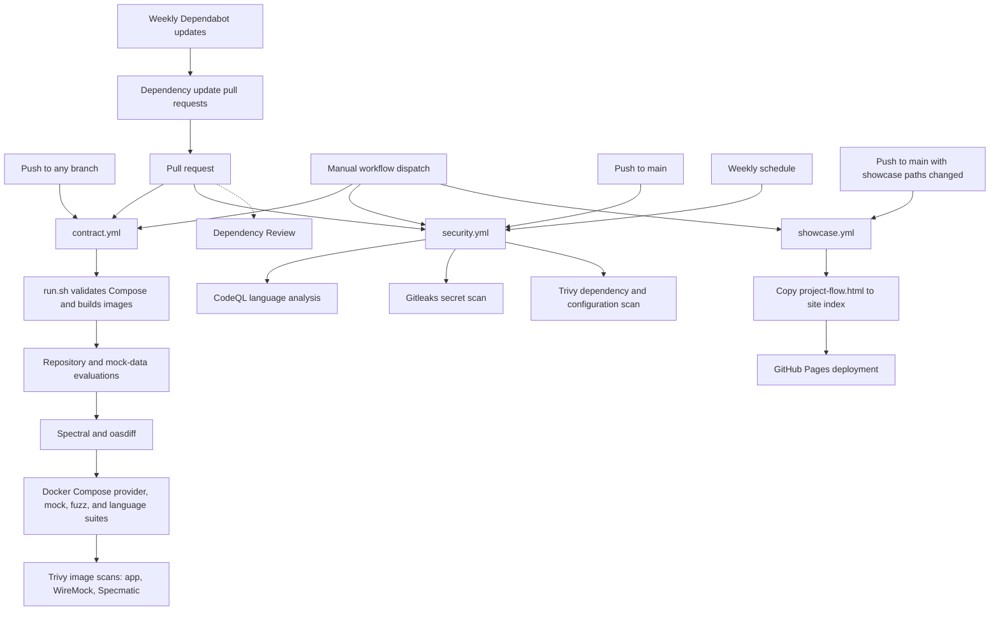
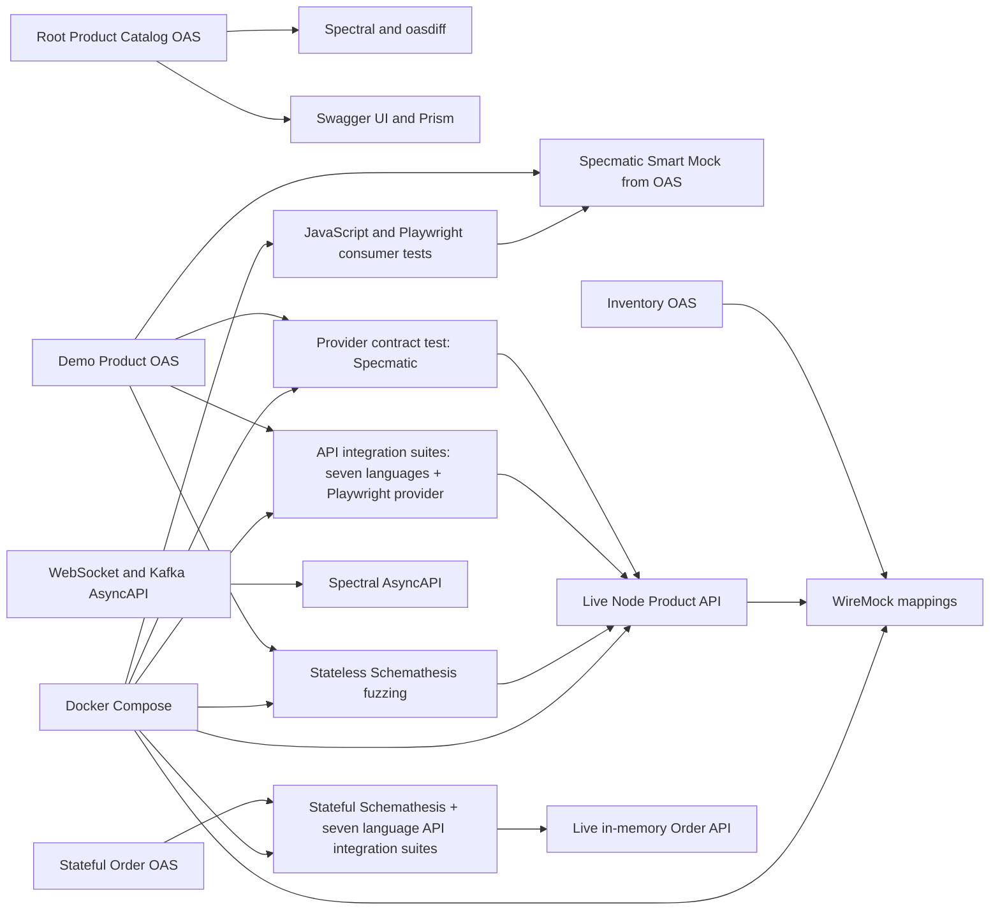

# oas-polycontract

One hand-edited contract per API boundary. Native test suites validate live HTTP responses against that contract, while Specmatic checks provider and consumer behavior. The same command runs the examples locally and in CI.

[Open the interactive project showcase](https://shoman2020.github.io/oas-polycontract/). Use the buttons, slide markers, or keyboard arrows to explore the contract flow, pipeline, test roles, and performance insights. The slides change only when you choose to move.

See the [roadmap](ROADMAP.md) for implementation and verification progress.

## Quick start

Requirements: Docker Engine and Docker Compose. From the repository root:

```sh
bash ./run.sh
```

The runner lints OpenAPI and AsyncAPI contracts, checks compatibility, builds the demo and test clients, verifies WireMock and Specmatic behavior, runs stateless fuzzing and a separate linked-order stateful example, and validates live responses in Rust, Go, Python, JavaScript, TypeScript, Java, and C#. Playwright adds API provider and consumer examples. It also exercises Smart Mock examples and removes Compose containers when it exits.

On macOS, use Docker Desktop or Colima with Docker and Compose installed. Windows users can use WSL or Git Bash. GitHub Actions runs the same pipeline on Ubuntu.

## Repository evaluations

Before contract gates, `bash ./run.sh` evaluates README links and its project tree, checks that documented client suites exist, verifies the provider/consumer/integration test targets against Compose, maps the GitHub workflows, and checks the roadmap phase sequence. The evaluation definitions and runner are in [`evals/`](evals/). Mock-data evaluations reuse a checked-in case file to verify exact fixture responses and dictionary-backed fallback values against the running Smart Mock.

## Fuzzing and stateful tests

Schemathesis performs **stateless fuzzing** against the GET-only Product API: it generates independent requests from the OpenAPI contract, probes input boundaries, and checks the responses. Each case can run without depending on data created by an earlier case. [`demo/schemathesis.toml`](demo/schemathesis.toml) allows the documented `502` for `GET /products/{sku}` because the demo deliberately maps one SKU to an unavailable inventory service; other server errors still fail.

**Stateful testing** sequences related operations and reuses values returned by earlier requests. The Product API remains GET-only, so `run.sh` demonstrates stateful testing against a separate in-memory Order API in [`demo/stateful/`](demo/stateful/). Its OAS links let Schemathesis create an order, read or update it, delete it, and verify a later read returns `404`. The service is disposable and starts empty for each pipeline run.

Each of the seven language-native API integration suites also runs the same create → read → confirm → delete → verify-404 lifecycle against that stateful service. Each response is validated against the stateful OAS.

Run the focused example with Docker Compose:

```sh
docker compose --env-file .github/versions.env --profile test --profile mock build stateful-app
docker compose --env-file .github/versions.env --profile test --profile mock run --rm stateful-schemathesis
```

## Performance snapshot

The most recent green contract run completed in **about 6 minutes 27 seconds**, including API and contract checks, language suites, Playwright, and container image scans. An earlier cold run generated **115 Schemathesis cases in 2.07 seconds**, but failed on an unsupported-method response; that timing is diagnostic, not a passing benchmark. See the [passing contract run](https://github.com/shoman2020/oas-polycontract/actions/runs/44052746009) and [earlier diagnostic run](https://github.com/shoman2020/oas-polycontract/actions/runs/43935878603). Repeated cold and warm-cache runs are needed for a stable baseline.

Security workflows run CodeQL, Gitleaks, Trivy, and pull request dependency review. Runtime, image, and scanner versions are pinned in [`.github/versions.env`](.github/versions.env); Dependabot checks language package manifests weekly.

## Project landscape

Each API boundary has its own hand-edited contract. Tests, mocks, and debug views consume that contract; they do not become competing specifications.

| Boundary | Contract | Implementation or consumer | Checks |
|---|---|---|---|
| Product Catalog scaffold | [`openapi/openapi.yaml`](openapi/openapi.yaml) | No provider is included yet | Spectral, root baseline compatibility, Swagger UI, Prism |
| Runnable Product API | [`demo/openapi.yaml`](demo/openapi.yaml) | Node.js provider in `demo/app/` | Spectral, Specmatic provider, Schemathesis, seven language suites, Playwright, Smart Mock |
| Stateful order example | [`demo/stateful/openapi.yaml`](demo/stateful/openapi.yaml) | Isolated in-memory Node.js provider in `demo/stateful/` | Spectral, linked Schemathesis stateful phase, and seven native lifecycle integration tests |
| Inventory dependency | [`demo/downstream/openapi.yaml`](demo/downstream/openapi.yaml) | WireMock mappings in `demo/downstream/wiremock/` | Specmatic downstream validation and app integration assertions |
| Product events | `contracts/events/*.asyncapi.yaml` | No broker or event provider is included | AsyncAPI Spectral ruleset |

`run.sh` coordinates the applicable gates and examples through Compose. GitHub Actions calls the same entry point on Ubuntu. The root Catalog contract is a design scaffold; the demo Product API is the live service used by the client examples. Keep those roles distinct when adding tests.

## GitHub workflow structure

The workflows have separate responsibilities. The contract workflow runs the repository evaluations and full example pipeline, then scans the built app, WireMock, and Specmatic images. The security workflow runs CodeQL, Gitleaks, and a Trivy filesystem scan; Dependency Review runs only for pull requests. Dependabot opens dependency update pull requests on its weekly schedule. The showcase workflow prepares `docs/project-flow.html` for Pages when its paths change on `main` or when run manually.



The contract and security workflows scan different targets: runtime images belong to `contract.yml`; source dependencies and configuration belong to `security.yml`. Gitleaks is the repository secret scanner. The Pages workflow needs GitHub Pages configured with Actions as the source in repository settings.

## What runs against the application server

The runner starts the Node Product API and WireMock, then waits for their health checks before sending traffic. Specmatic provider verification, stateless Schemathesis, all seven language-native Product API suites, and the Playwright API suite call the app at `http://app:8080`. The app uses WireMock for inventory; consumer examples target a separate Smart Mock built from the same Product OAS.

The stateful example runs against the separate `stateful-app` container at `http://stateful-app:8082`. Schemathesis and all seven language-native suites use it for the linked order lifecycle; it does not add state-changing operations to the Product API.

## Test roles and source layout

Contract-based testing checks how each side uses the shared interface contract. Provider verification sends contract-derived requests to the live app; consumer tests send client requests to a Smart Mock generated from the same OAS. API integration testing uses code to call the running services, validates their responses against OAS, and checks application behavior, including dependency calls and stateful flows.

### Contract-based testing

| Test type | Source | Target | Purpose |
|---|---|---|---|
| Provider contract-based test | Specmatic `specmatic-provider` service | Live Product API at `http://app:8080` | Sends contract-derived requests to the provider and verifies its responses against the shared OAS. |
| Consumer contract-based test | JavaScript [`consumer-contract.test.mjs`](clients/js/consumer-contract.test.mjs) and Playwright [`consumer-contract.spec.mjs`](clients/playwright/consumer-contract.spec.mjs) | Specmatic Smart Mock at `http://specmatic-mock:9000` | Exercises client requests and expectations using responses generated from the Product OAS. |

### API integration testing

| Test type | Source | Target | Purpose |
|---|---|---|---|
| Product API integration test | Seven language-native suites ([entry points](clients/README.md#api-integration-testing)) and Playwright [`product-api-integration.spec.mjs`](clients/playwright/product-api-integration.spec.mjs) | Live Product API at `http://app:8080` | Sends real HTTP requests, validates status, media type, and response schema against OAS, then checks business behavior. |
| Stateful API integration test | Seven language-native stateful suites ([entry points](clients/README.md#api-integration-testing)) | Live Order API at `http://stateful-app:8082` | Runs create, read, confirm, delete, and post-delete `404` lifecycle checks against the stateful OAS. |
| Downstream service integration test | [`demo/app/tests/wiremock.integration.mjs`](demo/app/tests/wiremock.integration.mjs) | Product API and WireMock | Confirms the running app makes the expected inventory request to its dependency. |

Smart Mock fixture and dictionary checks are a separate evaluation: [`demo/app/tests/specmatic-mock.integration.mjs`](demo/app/tests/specmatic-mock.integration.mjs) uses [`evals/mock-data-evals.json`](evals/mock-data-evals.json) to check exact fixtures and allowed fallback values.

Specmatic uses the same API specification to verify providers and create Smart Mocks for consumers ([contract testing](https://docs.specmatic.io/contract_driven_api_development/contract_testing), [service virtualization](https://docs.specmatic.io/contract_driven_api_development/service_virtualization)). The consumer examples share the provider OAS; the repository does not publish a separate consumer-owned CDC contract.

To run these commands directly, pass the pinned image versions with `--env-file .github/versions.env`. For a full run, `bash ./run.sh` handles the startup and cleanup.

Provider verification asks whether the running API honors the shared contract. Specmatic sends contract-derived requests to the live Node service; this is the `specmatic-provider` Compose service and runs after the app health check.

```sh
docker compose --env-file .github/versions.env build app wiremock
docker compose --env-file .github/versions.env up -d wiremock app
docker compose --env-file .github/versions.env --profile test run --rm specmatic-provider
```

`specmatic-mock` starts a Smart Mock from the shared OAS. The JavaScript and Playwright consumer contract tests run against it. Separate native API integration suites call the live Product API.

```sh
docker compose --env-file .github/versions.env --profile mock up -d specmatic-mock
docker compose --env-file .github/versions.env --profile test --profile mock build js-api-integration-test specmatic-mock-integration-test playwright-consumer-contract-test
docker compose --env-file .github/versions.env --profile test --profile mock run --rm specmatic-mock-integration-test
docker compose --env-file .github/versions.env --profile test --profile mock run --rm js-consumer-contract-test
docker compose --env-file .github/versions.env --profile test --profile mock run --rm playwright-consumer-contract-test
```

`bash ./run.sh` runs both roles, plus the JavaScript consumer example and checks for deterministic external examples and dictionary-backed mock data.



## Contract formats and protocols

OpenAPI documents are commonly encoded as YAML or JSON; these file formats are separate from the API protocol and payload media types. The contract describes the HTTP interface and its declared payloads.

| Interface | Contract standard | Payload or wire formats |
|---|---|---|
| HTTP APIs | OpenAPI (OAS) | JSON (`application/json`), XML (`application/xml`), form and multipart data, text, and binary media types as described per operation. |
| WebSockets and event-driven APIs | AsyncAPI | JSON, XML, Avro, or Protobuf messages over WebSocket, Kafka, MQTT, AMQP, NATS, and supported brokers. |
| gRPC | Protocol Buffers service definitions | Protobuf messages over HTTP/2. |
| GraphQL | GraphQL SDL | GraphQL operations over HTTP; subscriptions may use WebSocket or SSE transports. |
| SOAP | WSDL | XML messages, commonly over HTTP. |

OpenAPI models HTTP operations and their request and response payloads, including JSON and XML. AsyncAPI models event channels and message payloads, including WebSocket and Kafka. When a service exposes both HTTP and event interfaces, link their contracts so teams can navigate the whole API surface.

[`contracts/events/`](contracts/events/) contains linted AsyncAPI examples for WebSocket and Kafka. They document message shapes only; no WebSocket server or Kafka broker is included in this demo.

## Language-native integration tests

The migration path is: inventory existing requests and assertions, map operations and schemas to OAS, hand-review the contract, then port only business assertions into the selected language suite. The OAS remains the shared validation source. Runtime response validators enforce status, media type, and schema before test code checks behavior.

The runnable suites live in [`clients/`](clients/). Each makes a real HTTP request to the demo API, validates the status, media type, and response body against `demo/openapi.yaml`, then keeps one business assertion in test code. The seven language-native suites cover Rust, Go, Python, JavaScript, TypeScript, Java, and C#. Playwright adds an APIRequestContext example in JavaScript without launching a browser. The root Product Catalog contract is a separate scaffold and currently has no service implementation; root-level tests do not target it.

| Language | Native test stack | OAS response validator |
|---|---|---|
| Rust | `cargo test` + `reqwest` | `jsonschema` with the response schema resolved from the OAS |
| Go | `testing` + `net/http` | `kin-openapi` request routing and `ValidateResponse` |
| Python | `pytest` + `requests` | `openapi-core` Requests adapters |
| JavaScript | Node `node:test` + `fetch` | `@oaverify/core` and YAML loader |
| TypeScript | Vitest + `fetch` | `@oaverify/core` and YAML loader; `tsc` runs first |
| Playwright API | [Playwright `APIRequestContext`](https://playwright.dev/docs/api-testing) | `@oaverify/core` validates the response adapted from Playwright's API response |
| Java | JUnit + REST Assured | Atlassian OpenAPI Request Validator filter |
| C# | xUnit + `HttpClient` | `NJsonSchema` using the response schema read from OAS YAML |

JavaScript and Playwright have separate test sources for each role. Their API integration suites call the live Product API; their consumer contract tests call Specmatic's Smart Mock. Both validate responses against the shared OAS, while the consumer examples use the contract-derived mock to develop and check client expectations. Migration notes and representative output are in [`clients/README.md`](clients/README.md).

The JavaScript, TypeScript, and Playwright images install from committed npm lockfiles with `npm ci`. Python installs from a hash-locked requirements file. Remaining Rust, Go, and C# lock-mode work is tracked in [Phase 9](ROADMAP.md#phase-9--reproducible-dependencies).

## Mock data patterns

The demo's Specmatic mock has three data sources, ordered by intent:

1. **Contract examples:** operation examples in [`demo/openapi.yaml`](demo/openapi.yaml) describe common responses in the contract. They are schema examples; for a deterministic Smart Mock response to a particular request, add a request-response mapping under `demo/openapi_examples/`.
2. **Named datasets:** files under [`demo/openapi_examples/`](demo/openapi_examples/) pair a concrete request with its deterministic response. The `vip-sku` request always returns the checked-in VIP response.
3. **Domain-shaped fallback:** [`demo/openapi_dictionary.yaml`](demo/openapi_dictionary.yaml) supplies meaningful values when the mock has no matching example. Dictionary lists are sampled pseudo-randomly, so don't use them when a test needs a specific response.

`bash ./run.sh` starts the Smart Mock and asserts deterministic demo and VIP examples plus a dictionary-backed fallback. To keep the mock running for manual exploration, use `docker compose --profile mock up specmatic-mock`; it listens on `http://localhost:9000`.

AI can help draft realistic, varied mock datasets from schemas and approved domain vocabulary. Review and validate generated data, remove secrets and personal data, then commit fixtures or dictionaries. Do not make live AI generation part of the contract or a deterministic CI test. See [Specmatic dictionaries](https://docs.specmatic.io/features/dictionary.html), [external examples](https://docs.specmatic.io/features/external_examples.html), and [service virtualization](https://docs.specmatic.io/spec_driven_api_development/service_virtualization).

## Project structure

```text
oas-polycontract/
|-- openapi/
|   |-- openapi.yaml                 # Root Product Catalog OAS (hand-edited)
|   `-- openapi.base.yaml            # Compatibility baseline
|-- contracts/events/                # AsyncAPI WebSocket and Kafka examples
|-- docs/
|   `-- project-flow.html            # Interactive, manually navigated overview
|-- evals/                           # Repository integrity evaluation definitions and runner
|-- demo/
|   |-- openapi.yaml                 # Runnable Product API contract
|   |-- schemathesis.toml            # Operation-scoped allowance for the documented 502
|   |-- openapi_examples/            # Deterministic Specmatic request/response data
|   |-- openapi_dictionary.yaml      # Domain-shaped Smart Mock fallback values
|   |-- app/                         # Product API provider
|   |   `-- tests/
|   |       |-- wiremock.integration.mjs       # App-to-dependency integration
|   |       `-- specmatic-mock.integration.mjs  # Smart Mock data evaluations
|   |-- stateful/                    # Isolated Order API provider and contract
|   |-- downstream/
|   |   |-- openapi.yaml             # Inventory dependency contract
|   |   `-- wiremock/                # Inventory stubs checked against that contract
|   `-- wiremock/                    # WireMock image definition
|-- clients/
|   |-- rust/                        # Native API integration with the live providers
|   |-- go/                          # Native API integration with the live providers
|   |-- python/                      # Native API integration with the live providers
|   |-- js/                          # API integration and Smart Mock consumer tests
|   |-- ts/                          # Native API integration with the live providers
|   |-- playwright/                  # Live API integration and Smart Mock consumer tests
|   |-- java/                        # Native API integration with the live providers
|   |-- csharp/                      # Native API integration with the live providers
|   `-- README.md                    # Migration steps and sample test output
|-- gates/
|   |-- lint/                        # OpenAPI and AsyncAPI Spectral rulesets
|   `-- breaking-change/             # Root OAS compatibility script
|-- .github/
|   |-- workflows/                  # Contract, security, and showcase workflows
|   |-- security/                    # Specmatic OpenVEX assessment
|   |-- versions.env                 # Runtime, tool, image, and scanner pins
|   |-- dependabot.yml               # Weekly dependency update configuration
|   `-- CODEOWNERS                   # Repository code owners
|-- docker-compose.yml               # Demo services, clients, and optional profiles
`-- run.sh                           # Local and CI pipeline entry point
```

The `debug` Compose profile serves Swagger UI on `http://localhost:8082` and Prism on `http://localhost:4010` from the root contract; those service definitions live in `docker-compose.yml`. The `mock` profile starts Specmatic Smart Mock on `http://localhost:9000`. Edit OAS server URLs for deployed environments. These profiles support manual exploration and do not replace the contract test pipeline.

## Contribute

Have a feature idea or found a bug? [Open an issue](https://github.com/shoman2020/oas-polycontract/issues). For bugs, include reproduction steps, expected and actual results, and relevant logs or environment details. See [`CONTRIBUTING.md`](CONTRIBUTING.md) before changing contracts.

