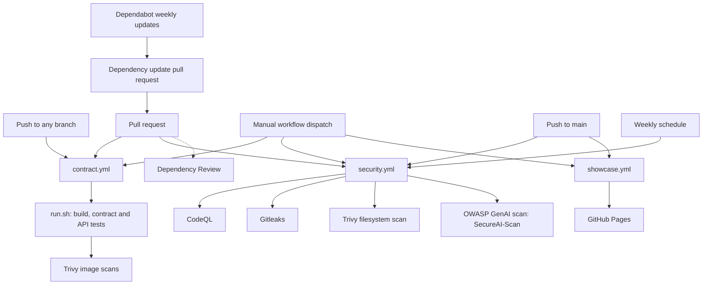

# oas-polycontract

One hand-edited contract per API boundary. Specmatic checks provider behavior against the live API and consumer expectations against a generated Smart Mock. Native suites validate live responses against the OAS.

[Interactive showcase](https://shoman2020.github.io/oas-polycontract/) · [Contract graph](docs/project-flow.html#contracts) · [Pipeline graph](docs/project-flow.html#pipeline) · [Workflow graph](docs/project-flow.html#workflows) · [Roadmap](ROADMAP.md)

## Run

Requirements: Docker Engine and Compose. From the repository root, run:

bash ./run.sh

This runs contract lint and compatibility checks, Specmatic and WireMock examples, stateless fuzzing, stateful Order API tests, and live API integration suites in Rust, Go, Python, JavaScript, TypeScript, Java, C#, and Playwright. Compose removes services at the end. Use Docker Desktop or Colima on macOS, WSL or Git Bash on Windows. GitHub Actions uses Ubuntu.

## Contracts

| Boundary | Contract | Implementation and checks |
|---|---|---|
| Product Catalog | [Root OAS](openapi/openapi.yaml) | Design scaffold; Spectral, oasdiff, Swagger UI, Prism |
| Product API | [Demo OAS](demo/openapi.yaml) | Node.js; Specmatic, Schemathesis, seven languages, Playwright |
| Order API | [Stateful OAS](demo/stateful/openapi.yaml) | In-memory Node.js; stateful Schemathesis and seven native suites |
| Inventory dependency | [Downstream OAS](demo/downstream/openapi.yaml) | WireMock mappings, Specmatic, downstream integration |
| Product events | [AsyncAPI examples](contracts/events/) | WebSocket and Kafka message contracts; lint only |

OpenAPI describes HTTP operations and payloads such as JSON and XML. AsyncAPI describes event messages and transports such as WebSocket and Kafka. No event provider or broker is included.

## Test roles

Contract-based tests verify conformance at either side of the shared contract. API integration tests call a running service, validate responses against OAS, then assert application behavior.

### Contract-based testing

| Test | Source | Target |
|---|---|---|
| Provider contract-based test | Specmatic provider verification | Live Product API, app:8080 |
| Consumer contract-based test | JavaScript and Playwright | Specmatic Smart Mock, specmatic-mock:9000 |

Consumers use the provider OAS; the project does not publish a separate CDC artifact.

### API integration testing

| Test | Source | Target |
|---|---|---|
| Product API integration test | Seven native suites and Playwright | Live Product API |
| Stateful API integration test | Seven native suites | Live Order API; create, read, confirm, delete, then 404 |
| Downstream service integration test | WireMock integration suite | Product API and WireMock request journal |

See the [client guide](clients/README.md) for test entry points, validators, migration, and sample output.

## Fuzzing and mock data

Schemathesis stateless fuzzing sends independent Product API requests. The documented 502 is allowed only for the unavailable-inventory lookup. Stateful Schemathesis follows linked Order API operations and reuses returned IDs; the Order service starts empty per run.

Specmatic mock data comes from OAS examples, deterministic fixtures in demo/openapi_examples, and dictionary values in demo/openapi_dictionary.yaml. Evaluations check exact examples and fallback values. AI-assisted fixture drafting is offline; review and validate generated data before committing. CI does not call a model.

## Security gates

contract.yml runs the demo pipeline and Trivy image scans. security.yml runs CodeQL, Gitleaks, Trivy filesystem checks, Dependency Review on pull requests, and the OWASP GenAI scan. Dependabot checks package manifests weekly.

Triggers: **Push to any branch**, **Push to main**, **Pull request**, **Weekly schedule**, and **Manual workflow dispatch**. See the [workflow graph](docs/project-flow.html#workflows).

SecureAI-Scan, listed by the [OWASP GenAI Security Project](https://genai.owasp.org/solution/secureai-scan/), checks AI, LLM, and MCP code. This repository has no runtime LLM or MCP integration. The gate prepares to check future additions, fails on high findings, and uploads SARIF to GitHub code scanning.

SecureAI-Scan supports JavaScript, TypeScript, and Python. Run focused scans when a target directory contains AI or MCP code:

```sh
source .github/versions.env
npx --yes "secureai-scan@$SECUREAI_SCAN_VERSION" scan clients/js --fail-on high
npx --yes "secureai-scan@$SECUREAI_SCAN_VERSION" scan clients/ts --fail-on high
npx --yes "secureai-scan@$SECUREAI_SCAN_VERSION" scan clients/python --fail-on high
```

The current client directories contain API tests, not AI integrations.

| Languages | OWASP GenAI scan |
|---|---|
| JavaScript, TypeScript, Python | SecureAI-Scan; examples above |
| Rust, Go, Java, C# | Not supported by this scanner. CodeQL covers these languages, but not AI-specific risks. |

Tool versions are in .github/versions.env.

### Workflow map

The same maps are available as navigable views in the [interactive showcase](docs/project-flow.html#workflows). Open the [contract graph](docs/project-flow.html#contracts) or the [pipeline graph](docs/project-flow.html#pipeline) there.



## Performance

The last green contract run, [44052746009](https://github.com/shoman2020/oas-polycontract/actions/runs/44052746009), took about **6m 27s**. An earlier diagnostic generated 115 Schemathesis cases in 2.07 seconds. Repeated cold and warm runs are needed for a stable baseline; see [Phase 12](ROADMAP.md#phase-12--performance-baseline).

## Project structure

| Path | Purpose |
|---|---|
| openapi/ | Root contract and compatibility baseline |
| contracts/events/ | AsyncAPI examples |
| demo/ | Product, Order, Inventory, WireMock, and mock data |
| clients/ | Rust, Go, Python, JS, TS, Java, C#, Playwright |
| gates/ | Lint and compatibility checks |
| evals/ | Documentation, roles, and pipeline checks |
| docs/project-flow.html | Interactive contract, pipeline, and workflow graphs |
| .github/workflows/ | Contract, security, and showcase automation |
| docker-compose.yml; run.sh | Local and CI pipeline |

## Contribute

Have a feature idea or found a bug? [Open an issue](https://github.com/shoman2020/oas-polycontract/issues). Include reproduction steps, expected and actual results, and useful logs. See [CONTRIBUTING.md](CONTRIBUTING.md).
