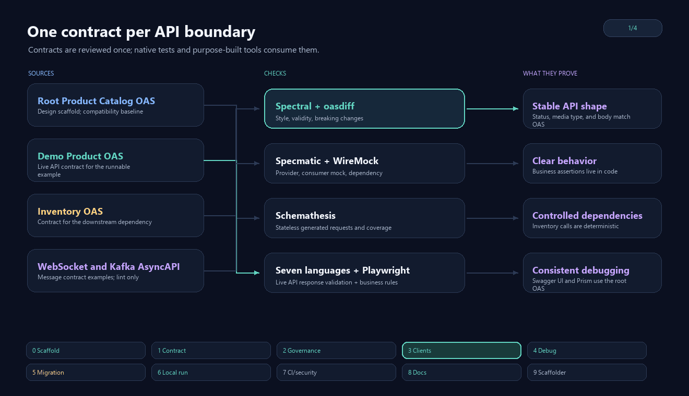
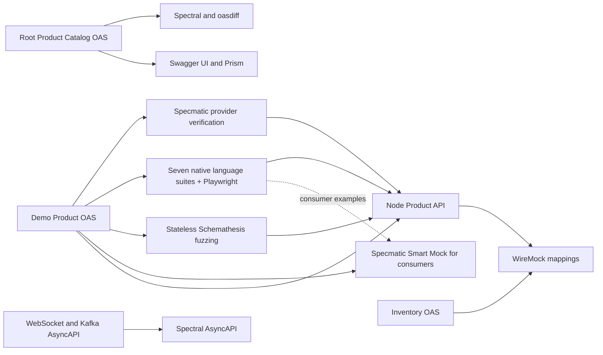

# oas-polycontract

One hand-edited contract per API boundary. Native test suites validate live HTTP responses against that contract, while Specmatic checks provider and consumer behavior. The same command runs the examples locally and in CI.



The animation shows how the contracts flow through the pipeline, which phases are implemented, how to start a run, and what the latest performance sample does and does not prove. See the [roadmap](ROADMAP.md) for detailed progress.

## Quick start

Requirements: Docker Engine and Docker Compose. From the repository root:

```sh
bash ./run.sh
```

The runner lints OpenAPI and AsyncAPI contracts, checks compatibility, builds the demo and test clients, verifies WireMock and Specmatic behavior, runs stateless fuzzing, validates live responses with seven languages and Playwright, and exercises Smart Mock examples. It removes Compose containers when it exits.

On macOS, use Docker Desktop or Colima with Docker and Compose installed. Windows users can use WSL or Git Bash. GitHub Actions runs the same pipeline on Ubuntu.

## Fuzzing and stateful tests

Schemathesis performs **stateless fuzzing** in `bash ./run.sh`: it generates independent requests from the OpenAPI contract, probes input boundaries, and checks the responses. Each case can run without depending on data created by an earlier case.

**Stateful testing** sequences related operations while keeping server state between requests, such as creating an order, reading it, and then cancelling it. The current Product API exposes read-only `GET` operations and uses fixed inventory fixtures, so there is no lifecycle to exercise; Schemathesis reports its stateful phase as not applicable. Add stateful coverage when a contract includes state-changing operations and links or fixtures that describe valid sequences.

## Performance snapshot

A cold Ubuntu CI sample built the app and seven client images in about **67 seconds**. Schemathesis generated **115 cases in 2.07 seconds**. The whole job took **2 minutes 44 seconds**, including image security scans. It caught an unsupported `TRACE /healthz` response before the language suites ran, so these are diagnostic measurements rather than a passing end-to-end benchmark. See [workflow run 43935878603](https://github.com/shoman2020/oas-polycontract/actions/runs/43935878603). Warm-cache timings and a green full-suite run are still needed for a stable performance baseline.

Security workflows run CodeQL, Gitleaks, Trivy, and pull request dependency review. Runtime, image, and scanner versions are pinned in [`.github/versions.env`](.github/versions.env); Dependabot checks language package manifests weekly.

## Project landscape

Each API boundary has its own hand-edited contract. Tests, mocks, and debug views consume that contract; they do not become competing specifications.

| Boundary | Contract | Implementation or consumer | Checks |
|---|---|---|---|
| Product Catalog scaffold | [`openapi/openapi.yaml`](openapi/openapi.yaml) | No provider is included yet | Spectral, root baseline compatibility, Swagger UI, Prism |
| Runnable Product API | [`demo/openapi.yaml`](demo/openapi.yaml) | Node.js provider in `demo/app/` | Spectral, Specmatic provider, Schemathesis, seven language suites, Playwright, Smart Mock |
| Inventory dependency | [`demo/downstream/openapi.yaml`](demo/downstream/openapi.yaml) | WireMock mappings in `demo/downstream/wiremock/` | Specmatic downstream validation and app integration assertions |
| Product events | `contracts/events/*.asyncapi.yaml` | No broker or event provider is included | AsyncAPI Spectral ruleset |

`run.sh` coordinates the applicable gates and examples through Compose. GitHub Actions calls the same entry point on Ubuntu. The root Catalog contract is a design scaffold; the demo Product API is the live service used by the client examples. Keep those roles distinct when adding tests.

## What runs against the application server

The runner starts the Node Product API and WireMock, then waits for their health checks before sending traffic. Specmatic provider verification, Schemathesis, all seven language-native suites, and the Playwright API suite call the app at `http://app:8080`. The app uses WireMock for inventory; consumer examples target a separate Smart Mock built from the same Product OAS.

## Provider and consumer contract examples

| Test role | Runner and target | What it checks |
|---|---|---|
| Provider contract verification | Specmatic `test` → healthy Node API at `http://app:8080` | The provider's live responses comply with the shared OAS. |
| Consumer-side contract example | JavaScript and Playwright → Specmatic Smart Mock at `http://specmatic-mock:9000` | Consumer requests and handling work against a mock generated from the provider OAS. |
| API integration | Seven language suites and Playwright → healthy Node API | Real server responses pass OAS validation and an explicit business assertion. |

Specmatic uses the same API specification to verify providers and create Smart Mocks for consumers ([contract testing](https://docs.specmatic.io/contract_driven_api_development/contract_testing), [service virtualization](https://docs.specmatic.io/contract_driven_api_development/service_virtualization)). This example shares the provider contract with consumers; it does not publish a separate consumer-owned CDC contract.

To run these commands directly, pass the pinned image versions with `--env-file .github/versions.env`. For a full run, `bash ./run.sh` handles the startup and cleanup.

Provider verification asks whether the running API honors the shared contract. Specmatic sends contract-derived requests to the live Node service; this is the `specmatic-provider` Compose service and runs after the app health check.

```sh
docker compose --env-file .github/versions.env build app wiremock
docker compose --env-file .github/versions.env up -d wiremock app
docker compose --env-file .github/versions.env --profile test run --rm specmatic-provider
```

`specmatic-mock` starts a Smart Mock from the shared OAS. The JavaScript and Playwright consumer suites run against it and validate the mock responses. Their separate live-provider runs are API integration tests.

```sh
docker compose --env-file .github/versions.env --profile mock up -d specmatic-mock
docker compose --env-file .github/versions.env build specmatic-mock-integration-test playwright-consumer-test
docker compose --env-file .github/versions.env --profile test --profile mock run --rm specmatic-mock-integration-test
docker compose --env-file .github/versions.env --profile test --profile mock run --rm playwright-consumer-test
```

`bash ./run.sh` runs both roles, plus the JavaScript consumer example and checks for inline, external, and dictionary-backed mock data.



## Contract formats and protocols

OpenAPI documents are commonly encoded as YAML or JSON; these file formats are separate from the API protocol and payload media types. The contract describes the HTTP interface and its declared payloads.

| Interface | Contract standard | Payload or wire formats |
|---|---|---|
| HTTP APIs | OpenAPI (OAS) | JSON (`application/json`), XML (`application/xml`), form and multipart data, text, and binary media types as described per operation. |
| WebSockets and event-driven APIs | AsyncAPI | JSON, XML, Avro, or Protobuf messages over WebSocket, Kafka, MQTT, AMQP, NATS, and supported brokers. |
| gRPC | Protocol Buffers service definitions | Protobuf messages over HTTP/2. |
| GraphQL | GraphQL SDL | GraphQL operations over HTTP; subscriptions may use WebSocket or SSE transports. |
| SOAP | WSDL | XML messages, commonly over HTTP. |

OpenAPI models HTTP operations and their request and response payloads, including JSON and XML. AsyncAPI models event channels and message payloads, including WebSocket and Kafka. When a service exposes both HTTP and event interfaces, link their contracts so teams can navigate the whole API surface.

[`contracts/events/`](contracts/events/) contains linted AsyncAPI examples for WebSocket and Kafka. They document message shapes only; no WebSocket server or Kafka broker is included in this demo.

## Language-native integration tests

The migration path is: inventory existing requests and assertions, map operations and schemas to OAS, hand-review the contract, then port only business assertions into the selected language suite. The OAS remains the shared validation source. Runtime response validators enforce status, media type, and schema before test code checks behavior.

The runnable suites live in [`clients/`](clients/). Each makes a real HTTP request to the demo API, validates the status, media type, and response body against `demo/openapi.yaml`, then keeps one business assertion in test code. The seven language-native suites cover Rust, Go, Python, JavaScript, TypeScript, Java, and C#. Playwright adds an APIRequestContext example in JavaScript without launching a browser. The root Product Catalog contract is a separate scaffold and currently has no service implementation; root-level tests do not target it.

| Language | Native test stack | OAS response validator |
|---|---|---|
| Rust | `cargo test` + `reqwest` | `jsonschema` with the response schema resolved from the OAS |
| Go | `testing` + `net/http` | `kin-openapi` request routing and `ValidateResponse` |
| Python | `pytest` + `requests` | `openapi-core` Requests adapters |
| JavaScript | Node `node:test` + `fetch` | `@oaverify/core` and YAML loader |
| TypeScript | Vitest + `fetch` | `@oaverify/core` and YAML loader; `tsc` runs first |
| Playwright API | [Playwright `APIRequestContext`](https://playwright.dev/docs/api-testing) | `@oaverify/core` validates the response adapted from Playwright's API response |
| Java | JUnit + REST Assured | Atlassian OpenAPI Request Validator filter |
| C# | xUnit + `HttpClient` | `NJsonSchema` using the response schema read from OAS YAML |

The JavaScript and Playwright suites each run against both the live provider and Specmatic's Smart Mock. The live-provider run is an API integration test; the mock-backed run demonstrates consumer-side development against the same OAS. Both keep business assertions in code and validate response shape against the contract. Migration notes and representative output are in [`clients/README.md`](clients/README.md).

## Mock data patterns

The demo's Specmatic mock has three data sources, ordered by intent:

1. **Exact scenarios:** operation examples in [`demo/openapi.yaml`](demo/openapi.yaml) describe common responses. Use these when a response must be fixed and visible with the API contract.
2. **Named datasets:** files under [`demo/openapi_examples/`](demo/openapi_examples/) pair a concrete request with its deterministic response. The `vip-sku` request always returns the checked-in VIP response.
3. **Domain-shaped fallback:** [`demo/openapi_dictionary.yaml`](demo/openapi_dictionary.yaml) supplies meaningful values when the mock has no matching example. Dictionary lists are sampled pseudo-randomly, so don't use them when a test needs a specific response.

`bash ./run.sh` starts the Smart Mock and asserts the inline example, external VIP example, and dictionary-backed fallback. To keep the mock running for manual exploration, use `docker compose --profile mock up specmatic-mock`; it listens on `http://localhost:9000`.

AI can help draft realistic, varied mock datasets from schemas and approved domain vocabulary. Review and validate generated data, remove secrets and personal data, then commit fixtures or dictionaries. Do not make live AI generation part of the contract or a deterministic CI test. See [Specmatic dictionaries](https://docs.specmatic.io/features/dictionary.html), [external examples](https://docs.specmatic.io/features/external_examples.html), and [service virtualization](https://docs.specmatic.io/spec_driven_api_development/service_virtualization).

## Project structure

```text
oas-polycontract/
|-- openapi/
|   |-- openapi.yaml                 # Root Product Catalog OAS (hand-edited)
|   `-- openapi.base.yaml            # Compatibility baseline
|-- contracts/events/                # AsyncAPI WebSocket and Kafka examples
|-- docs/                            # Animated overview and Pillow generator
|-- demo/
|   |-- openapi.yaml                 # Runnable Product API contract
|   |-- openapi_examples/            # Deterministic Specmatic request/response data
|   |-- openapi_dictionary.yaml      # Domain-shaped fallback values for Smart Mock
|   |-- app/                         # Node provider and integration assertions
|   |-- downstream/
|   |   |-- openapi.yaml             # Inventory dependency contract
|   |   `-- wiremock/                # Dependency stubs checked against that contract
|   `-- wiremock/                    # Patched WireMock container definition
|-- clients/
|   |-- rust/
|   |-- go/
|   |-- python/
|   |-- js/
|   |-- ts/
|   |-- playwright/                  # Playwright APIRequestContext provider and consumer examples
|   |-- java/
|   |-- csharp/                      # Native integration tests
|   `-- README.md                    # Migration steps and sample test output
|-- gates/
|   |-- lint/                        # OpenAPI and AsyncAPI Spectral rules
|   `-- breaking-change/             # Root OAS compatibility check
|-- .github/
|   |-- workflows/                  # Contract pipeline and security scans
|   |-- security/                    # Specmatic OpenVEX assessment
|   `-- versions.env                 # Runtime, tool, image, and scanner pins
|-- docker-compose.yml               # Demo services, clients, and optional profiles
`-- run.sh                           # Local and CI pipeline entry point
```

The `debug` profile serves Swagger UI on `http://localhost:8082` and Prism on `http://localhost:4010` from the root contract. The `mock` profile starts Specmatic Smart Mock on `http://localhost:9000`. Edit OAS server URLs for deployed environments. These profiles support manual exploration and do not replace the contract test pipeline.

## Contribute

Have a feature idea or found a bug? [Open an issue](https://github.com/shoman2020/oas-polycontract/issues). For bugs, include reproduction steps, expected and actual results, and relevant logs or environment details. See [`CONTRIBUTING.md`](CONTRIBUTING.md) before changing contracts.

