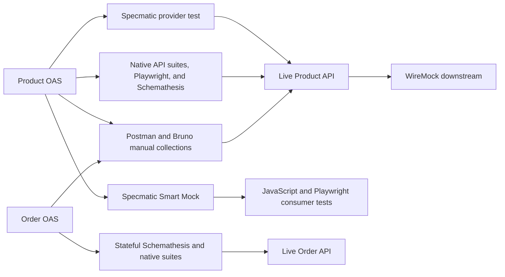
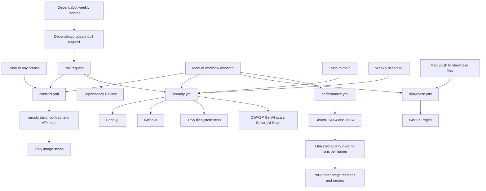

# oas-polycontract

One hand-edited contract per API boundary. Specmatic checks provider behavior against the live API and consumer expectations against a generated Smart Mock. Native suites validate live responses against the OAS.

## Purpose

API testing gets harder when teams maintain overlapping specifications, duplicate requests, and unclear test ownership. This project demonstrates a contract-first model: keep the API contract under review, use it to drive provider and consumer checks, and validate live behavior in code-based integration suites. Specmatic and Schemathesis cover their contract and fuzzing roles. Swagger UI and Prism preview the root Catalog scaffold; Postman and Bruno examples target the runnable Product and Order APIs. Reducing duplicate specs and overlapping tools can lower maintenance and tooling costs. Standard contracts stay usable when teams change clients, test frameworks, or vendors. One contract owner means less maintenance and more trust.

[Interactive showcase](https://shoman2020.github.io/oas-polycontract/) · [Contracts](https://shoman2020.github.io/oas-polycontract/#contracts) · [Test roles](https://shoman2020.github.io/oas-polycontract/#test-roles) · [Test behavior](https://shoman2020.github.io/oas-polycontract/#test-behavior) · [Pipeline](https://shoman2020.github.io/oas-polycontract/#pipeline) · [Workflows](https://shoman2020.github.io/oas-polycontract/#workflows) · [Performance](https://shoman2020.github.io/oas-polycontract/#performance) · [Roadmap](ROADMAP.md)

## Flow overview

These diagrams render in this README. Open the [interactive showcase](https://shoman2020.github.io/oas-polycontract/) for the full project, pipeline, workflow, and performance maps.

### Contract and test flow



### CI workflow



## Run

Requires Docker Engine and Compose:

```sh
bash ./run.sh
```

`run.sh` runs contract lint and compatibility checks, Specmatic and WireMock examples, stateless fuzzing, stateful Order API tests, and live API suites in Rust, Go, Python, JavaScript, TypeScript, Java, C#, and Playwright. Compose removes services afterward. Use Docker Desktop or Colima on macOS, WSL or Git Bash on Windows. CI uses Ubuntu.

Latest CI: [contract run 44256166253 passed](https://github.com/shoman2020/oas-polycontract/actions/runs/44256166253) in 4m 56s, including image scans; repository evaluations passed 11/11. [Security run 44256166254 passed](https://github.com/shoman2020/oas-polycontract/actions/runs/44256166254).

## Contracts

| Boundary | Contract | Implementation and checks |
|---|---|---|
| Product Catalog | [Root OAS](openapi/openapi.yaml) | Design scaffold; Spectral, oasdiff, Swagger UI, Prism |
| Product API | [Demo OAS](demo/openapi.yaml) | Node.js; Specmatic, Schemathesis, seven languages, Playwright |
| Order API | [Stateful OAS](demo/stateful/openapi.yaml) | In-memory Node.js; stateful Schemathesis and seven native suites |
| Inventory dependency | [Downstream OAS](demo/downstream/openapi.yaml) | WireMock mappings, Specmatic, downstream integration |
| Product events | [AsyncAPI examples](contracts/events/) | WebSocket and Kafka message contracts; lint only |

OpenAPI covers HTTP operations and payloads such as JSON and XML. AsyncAPI covers event messages over WebSocket and Kafka. Event examples are linted; no event provider or broker is included.

## Test roles

Contract-based tests verify either side of the shared contract. API integration tests call a running service, validate responses against OAS, then assert behavior.

### Contract-based testing

| Test | Source | Target |
|---|---|---|
| Provider contract-based test | Specmatic provider verification | Live Product API, app:8080 |
| Consumer contract-based test | JavaScript and Playwright | Specmatic Smart Mock, specmatic-mock:9000 |

Consumers use the provider OAS; no separate CDC artifact is published.

### API integration testing

| Test | Source | Target |
|---|---|---|
| Product API integration test | Seven native suites and Playwright | Live Product API |
| Stateful API integration test | Seven native suites | Live Order API; create, read, confirm, delete, then 404 |
| Downstream service integration test | WireMock integration suite | Product API and WireMock request journal |

### Manual debugging and collection migration

The [Postman and Bruno collections](legacy/) follow the Product and Order OAS for interactive requests. They support manual debugging and migration of older request workflows. See [legacy/README.md](legacy/README.md) for import and local-service instructions. CI runs Specmatic, Schemathesis, WireMock, and code-based API integration checks.

See the [client guide](clients/README.md) for test entry points, validators, migration, and sample output.

## Fuzzing and mock data

Stateless Schemathesis fuzzing sends independent Product API requests. Only the unavailable-inventory lookup allows the documented 502. Stateful Schemathesis follows linked Order operations and reuses returned IDs; the Order service starts empty per run.

Specmatic mock data uses OAS examples, fixtures in `demo/openapi_examples`, and values in `demo/openapi_dictionary.yaml`. Repository evaluations check fixture responses and dictionary fallbacks. Keep sample data deterministic and review changes before committing.

## Security gates

contract.yml runs the demo pipeline and Trivy image scans. security.yml runs CodeQL, Gitleaks, Trivy filesystem checks, Dependency Review on pull requests, and the OWASP GenAI scan. Dependabot checks package manifests weekly.

Triggers: **Push to any branch**, **Push to main**, **Pull request**, **Weekly schedule**, and **Manual workflow dispatch**. See the [interactive workflow map](https://shoman2020.github.io/oas-polycontract/#workflows).

The [OWASP SecureAI-Scan](https://genai.owasp.org/solution/secureai-scan/) gate checks AI, LLM, and MCP source, fails on high findings, and uploads SARIF. This project has no runtime AI or MCP integration.

The workflow provides SecureAI-Scan examples for JavaScript, TypeScript, and Python. Run a focused scan when those folders contain AI or MCP code:

```sh
source .github/versions.env
npx --yes "secureai-scan@$SECUREAI_SCAN_VERSION" scan clients/js --fail-on high
npx --yes "secureai-scan@$SECUREAI_SCAN_VERSION" scan clients/ts --fail-on high
npx --yes "secureai-scan@$SECUREAI_SCAN_VERSION" scan clients/python --fail-on high
```

The current client directories contain API tests only. Rust, Go, Java, and C# are included in the CodeQL matrix; CodeQL is general static analysis, not an AI-specific ruleset.

| Language | OWASP AI example | General source analysis |
|---|---|---|
| JavaScript | `scan clients/js --fail-on high` | CodeQL `javascript-typescript` |
| TypeScript | `scan clients/ts --fail-on high` | CodeQL `javascript-typescript` |
| Python | `scan clients/python --fail-on high` | CodeQL `python` |
| Rust | Not supported by SecureAI-Scan | CodeQL `rust` |
| Go | Not supported by SecureAI-Scan | CodeQL `go` |
| Java | Not supported by SecureAI-Scan | CodeQL `java-kotlin` |
| C# | Not supported by SecureAI-Scan | CodeQL `csharp` |

Tool versions are in .github/versions.env.

## Performance

Each contract run reports stage timings and uploads a CSV artifact. A five-sample run measured a **304s cold total** and **201s warm median** (200–205s range); build time fell from 91s to 2s after caching. This single-runner result is a reference, not an SLA. The manual benchmark now compares Ubuntu 24.04 and 26.04, with one cold and four warm runs on each. See the [run report](https://github.com/shoman2020/oas-polycontract/actions/runs/44146642941), [performance view](https://shoman2020.github.io/oas-polycontract/#performance), and [Phase 12](ROADMAP.md#phase-12--performance-baseline).

## Project structure

| Path | Purpose |
|---|---|
| openapi/ | Root contract and compatibility baseline |
| contracts/events/ | AsyncAPI examples |
| demo/ | Product, Order, Inventory, WireMock, and mock data |
| legacy/ | Postman and Bruno collections adapted from project contracts |
| clients/ | Rust, Go, Python, JS, TS, Java, C#, Playwright |
| clients/rust/Cargo.lock; clients/go/go.sum; clients/csharp/packages.lock.json | Rust, Go, and .NET dependency locks |
| gates/ | Lint and compatibility checks |
| evals/ | Documentation, roles, and pipeline checks |
| docs/project-flow.html | Interactive showcase source, published on GitHub Pages |
| .github/workflows/ | Contract, security, and showcase automation |
| docker-compose.yml; run.sh | Local and CI pipeline |

## Contribute

Have a feature idea or found a bug? [Open an issue](https://github.com/shoman2020/oas-polycontract/issues). Include reproduction steps, expected and actual results, and useful logs. See [CONTRIBUTING.md](CONTRIBUTING.md).
