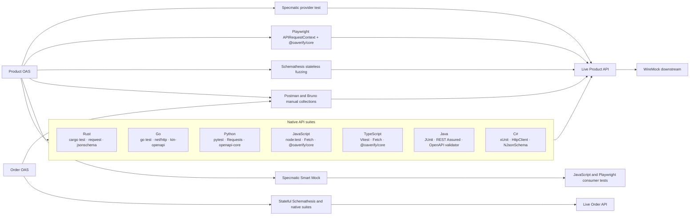
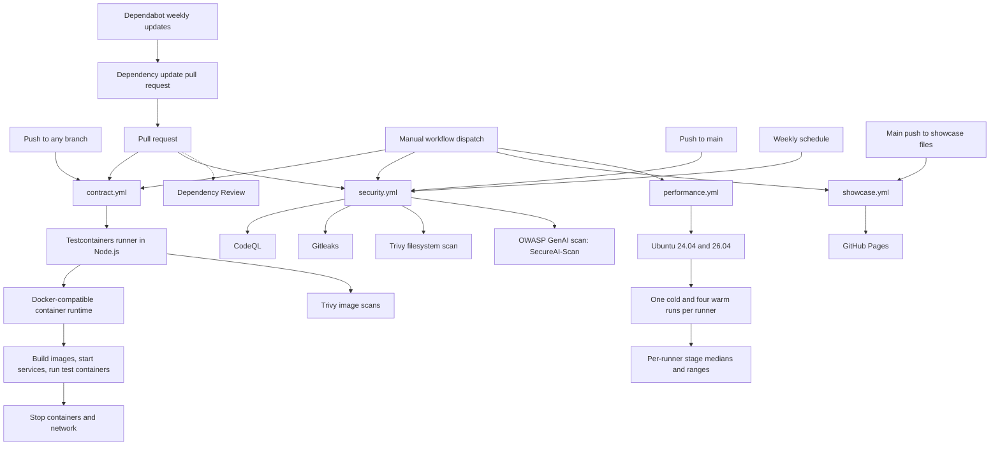

# oas-polycontract

Give each API boundary one shared specification: OAS for HTTP and AsyncAPI for events. Reuse it across provider verification, consumer mocks, and native integration suites to reduce duplicate definitions and maintenance costs while keeping tools replaceable.

## Purpose

- Keep one reviewed contract for each API boundary; use it for provider and consumer checks.
- Validate live behavior with native integration suites. Specmatic covers contract tests; Schemathesis covers fuzzing and stateful flows.
- Use Swagger UI and Prism to inspect the Catalog scaffold; use the Postman and Bruno examples with the runnable Product and Order APIs.
- Reduce duplicate specs and overlapping tools to lower maintenance and tooling costs.
- Keep contracts usable across clients, test frameworks, and vendors. One contract owner means less maintenance and more trust.

[Interactive showcase](https://shoman2020.github.io/oas-polycontract/) · [Contracts](https://shoman2020.github.io/oas-polycontract/#contracts) · [Test roles](https://shoman2020.github.io/oas-polycontract/#test-roles) · [Test behavior](https://shoman2020.github.io/oas-polycontract/#test-behavior) · [Pipeline](https://shoman2020.github.io/oas-polycontract/#pipeline) · [Workflows](https://shoman2020.github.io/oas-polycontract/#workflows) · [Performance](https://shoman2020.github.io/oas-polycontract/#performance) · [Roadmap](ROADMAP.md)

## Flow overview

These diagrams render in this README. Open the [interactive showcase](https://shoman2020.github.io/oas-polycontract/) for the full project, pipeline, workflow, and performance maps.

### Contract and test flow



Native suites are code-based API integration tests: they call the running API, validate responses against OAS, and assert behavior in each language's test framework. Specmatic separates contract roles: provider tests hit the live Product API, and consumer tests hit the Smart Mock. Schemathesis generates Product fuzz cases and stateful Order flows. Playwright uses APIRequestContext, not browser UI automation.

### CI workflow



## Run

Requires Node.js 26, npm 12.2.2, and a Docker-compatible container runtime. Testcontainers for Node.js manages the pipeline; Docker Compose is not required.

```sh
bash ./run.sh
```

`run.sh` checks the pinned Node.js/npm versions, installs the locked pipeline dependency, and starts an isolated Testcontainers network. It runs repository evaluations and contract gates, builds the project images, starts the APIs, executes Specmatic/WireMock examples, fuzzing and API suites, then stops the containers and network. Task containers receive only needed contract or fixture paths as read-only mounts. Use Docker Desktop or Colima on macOS, or Docker Desktop with WSL/Git Bash on Windows. CI uses Ubuntu.

Last remote pull request checks, 18 Nov 2026: [contract run 44325433591 passed](https://github.com/shoman2020/oas-polycontract/actions/runs/44325433591) and [security run 44325434450 passed](https://github.com/shoman2020/oas-polycontract/actions/runs/44325434450). The contract workflow publishes stage timings as a CSV artifact.

## Contracts

| Boundary | Contract | Implementation and checks |
|---|---|---|
| Product Catalog | [Root OAS](openapi/openapi.yaml) | Design scaffold; Spectral, oasdiff, Swagger UI, Prism |
| Product API | [Demo OAS](demo/openapi.yaml) | Node.js; Specmatic, Schemathesis, seven languages, Playwright |
| Order API | [Stateful OAS](demo/stateful/openapi.yaml) | In-memory Node.js; stateful Schemathesis and seven native suites |
| Inventory dependency | [Downstream OAS](demo/downstream/openapi.yaml) | WireMock mappings, Specmatic, downstream integration |
| Product events | [AsyncAPI examples](contracts/events/) | WebSocket and Kafka message contracts; lint only |

OpenAPI describes HTTP operations and payloads such as JSON and XML. AsyncAPI describes event messages over WebSocket and Kafka. JSON, YAML, and XML describe document or payload formats; the contract separately defines the interface and transport. Event examples are linted; no event provider or broker is included.

## Architecture

| Layer | Responsibility | Source |
|---|---|---|
| Specifications | Define each API boundary and examples; one OAS for HTTP and AsyncAPI for events | `openapi/`, `demo/`, `contracts/events/` |
| Demo services | Implement Product, Order, and WireMock-backed Inventory examples | `demo/` |
| Native clients | Encapsulate HTTP calls; validators check OAS conformance and tests assert API behavior | `clients/` |
| Orchestration | Compose pipeline stages, containers, network, and cleanup | `pipeline/run.mjs` |
| Shared configuration | Parse and validate required runtime pins before container startup | `pipeline/config.mjs`, `.github/versions.env` |
| Quality checks | Validate contracts, project wiring, security, and dependencies | `gates/`, `evals/`, `.github/workflows/` |

The pipeline runner is the composition root: it starts services and calls the specialized gates and client suites. Each language keeps its API client and assertions in that language's native test stack. See the [client guide](clients/README.md) for the implementation map.

## Testing model and terminology

Use these terms consistently across the contracts, tests, and pipeline:

| Term | Meaning in this project |
|---|---|
| OAS | OpenAPI Specification; describes HTTP operations and request/response data. |
| AsyncAPI | Specification for event-driven interfaces such as Kafka and WebSocket messages. |
| Specification | Machine-readable interface definition, such as OAS or AsyncAPI. |
| Contract | The agreed interface behavior expressed by its specification. |
| Provider contract test | Specmatic sends contract-derived requests to the running Product API. |
| Consumer contract test | JavaScript and Playwright consumer tests check expected responses from a Specmatic Smart Mock generated from the Product OAS. |
| Smart Mock | Specmatic server that returns responses defined by the provider's contract and examples. |
| API integration test | A native suite calls a running application, validates status, media type, and schema, then asserts behavior. |
| Schema validation | Checks response shape and declared media type; it does not replace behavior assertions. |
| Stateless fuzzing | Schemathesis generates independent Product requests from the OAS. |
| Stateful testing | Linked operations share returned data; Order tests follow create, read, confirm, delete, then 404. |
| Quality gate | A CI check that reports whether a change meets a stated requirement; merge enforcement is configured separately. |

The provider and consumer tests share the Product OAS but target different systems. API integration suites exercise live services. Consumers use the provider OAS; this project does not publish a separate CDC artifact.

### Contract-based testing

| Role | Implementation | Target |
|---|---|---|
| Provider | Specmatic provider verification | Live Product API, app:8080 |
| Consumer | JavaScript and Playwright tests | Specmatic Smart Mock, specmatic-mock:9000 |

### API integration testing

| Test | Source | Target |
|---|---|---|
| Product API integration test | Seven native suites and Playwright | Live Product API |
| Stateful API integration test | Seven native suites | Live Order API; create, read, confirm, delete, then 404 |
| Downstream service integration test | WireMock integration suite | Product API and WireMock request journal |

### Manual debugging and collection migration

The [Postman and Bruno collections](legacy/) follow the Product and Order OAS for interactive requests and migration of older request workflows. See [legacy/README.md](legacy/README.md) for import and local-service instructions.

See the [client guide](clients/README.md) for test entry points, validators, migration, and sample output.

## Fuzzing and mock data

Stateless Schemathesis fuzzing sends independent Product API requests. Only the unavailable-inventory lookup allows the documented 502. Stateful Schemathesis follows linked Order operations and reuses returned IDs; the Order service starts empty per run.

Specmatic mock data uses OAS examples, fixtures in `demo/openapi_examples`, and values in `demo/openapi_dictionary.yaml`. Repository evaluations check fixture responses and dictionary fallbacks. Keep sample data deterministic and review changes before committing.

## Quality gates

| Gate | Check | Workflow |
|---|---|---|
| Contract quality | Spectral lint and OAS compatibility | `contract.yml` |
| API behavior | Specmatic provider and consumer checks, WireMock, Schemathesis, and native integration suites | `contract.yml` |
| Project consistency | Repository evaluations check links, structure, test roles, workflows, and roadmap | `contract.yml` |
| Source and dependencies | CodeQL, Gitleaks, Trivy filesystem scan, Dependency Review, and Dependabot | `security.yml` |
| Container images | Trivy scans for the app, WireMock, and Specmatic | `contract.yml` |
| GenAI code | SecureAI-Scan; fails on high findings and uploads SARIF | `security.yml` |

Dependabot checks package manifests weekly. Contract CI runs on pushes, pull requests, and manual dispatch. Security CI runs on pushes to `main`, pull requests, a weekly schedule, and manual dispatch. See the [interactive workflow map](https://shoman2020.github.io/oas-polycontract/#workflows).

The [OWASP SecureAI-Scan](https://genai.owasp.org/solution/secureai-scan/) gate checks AI, LLM, and MCP source. This project has no runtime AI or MCP integration, so CI also runs an isolated positive-control example: the [example script](gates/security/run-genai-example.mjs) creates a temporary TypeScript chat handler with user input in a system prompt, runs the `AI001` rule, checks that the finding crosses the configured high threshold, and records the result in the job summary. The generated SARIF is saved as the `secureai-genai-example` workflow artifact. The temporary source is removed before the full repository scan.

The verified example result is `HIGH AI001 — Prompt injection via user input`. SecureAI-Scan exits with code 1 at `--fail-on high`; the wrapper reports success only after confirming the SARIF contains `AI001`.

Run the positive-control example locally from Bash after sourcing the pinned version:

```sh
source .github/versions.env
export SECUREAI_SCAN_VERSION
node gates/security/run-genai-example.mjs
```

The project scan remains a separate gate and uploads its SARIF to GitHub Code Scanning. The demo's expected finding is kept as an artifact so it is visible without appearing as a repository vulnerability.

The workflow provides SecureAI-Scan examples for JavaScript, TypeScript, and Python. Run a focused scan when those folders contain AI or MCP code:

```sh
source .github/versions.env
npx --yes "secureai-scan@$SECUREAI_SCAN_VERSION" scan clients/js --fail-on high
npx --yes "secureai-scan@$SECUREAI_SCAN_VERSION" scan clients/ts --fail-on high
npx --yes "secureai-scan@$SECUREAI_SCAN_VERSION" scan clients/python --fail-on high
```

The current client directories contain API tests only. Rust, Go, Java, and C# are included in the CodeQL matrix; CodeQL is general static analysis, not an AI-specific ruleset.

| Language | OWASP AI example | General source analysis |
|---|---|---|
| JavaScript | `scan clients/js --fail-on high` | CodeQL `javascript-typescript` |
| TypeScript | `scan clients/ts --fail-on high` | CodeQL `javascript-typescript` |
| Python | `scan clients/python --fail-on high` | CodeQL `python` |
| Rust | Not supported by SecureAI-Scan | CodeQL `rust` |
| Go | Not supported by SecureAI-Scan | CodeQL `go` |
| Java | Not supported by SecureAI-Scan | CodeQL `java-kotlin` |
| C# | Not supported by SecureAI-Scan | CodeQL `csharp` |

Tool versions are in .github/versions.env.

## Performance

Each contract run reports stage timings and uploads a CSV artifact. The previous five-sample runner measured a **304s cold total** and **201s warm median** (200–205s range); cached build time fell from 91s to 2s. These are pre-Testcontainers reference figures, not an SLA. The Testcontainers workflow passed in [run 44325433591](https://github.com/shoman2020/oas-polycontract/actions/runs/44325433591). Rerun the manual benchmark on Ubuntu 24.04 and 26.04 before comparing performance. See the [previous benchmark](https://github.com/shoman2020/oas-polycontract/actions/runs/44146642941), [performance view](https://shoman2020.github.io/oas-polycontract/#performance), and [Phase 12](ROADMAP.md#phase-12--performance-baseline).

## Project structure

| Path | Purpose |
|---|---|
| openapi/ | Root contract and compatibility baseline |
| contracts/events/ | AsyncAPI examples |
| demo/ | Product, Order, Inventory, WireMock, and mock data |
| legacy/ | Postman and Bruno collections adapted from project contracts |
| clients/ | Rust, Go, Python, JS, TS, Java, C#, Playwright |
| clients/rust/Cargo.lock; clients/go/go.sum; clients/csharp/packages.lock.json | Rust, Go, and .NET dependency locks |
| gates/ | Contract lint, compatibility checks, and security examples |
| evals/ | Documentation, roles, and pipeline checks |
| docs/project-flow.html | Interactive showcase source, published on GitHub Pages |
| .github/workflows/ | Contract, security, performance, and showcase automation |
| .github/versions.env | Central tool and runtime version pins |
| pipeline/; run.sh | Testcontainers runner, strict runtime-version parser and tests, local/CI entry point |

## Contribute

Have a feature idea or found a bug? [Open an issue](https://github.com/shoman2020/oas-polycontract/issues). Include reproduction steps, expected and actual results, and useful logs. See [CONTRIBUTING.md](CONTRIBUTING.md).
