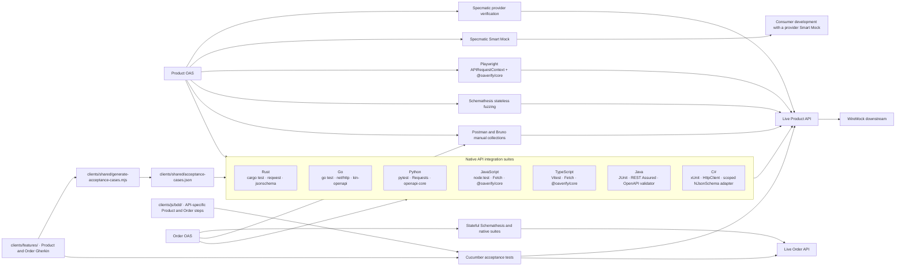
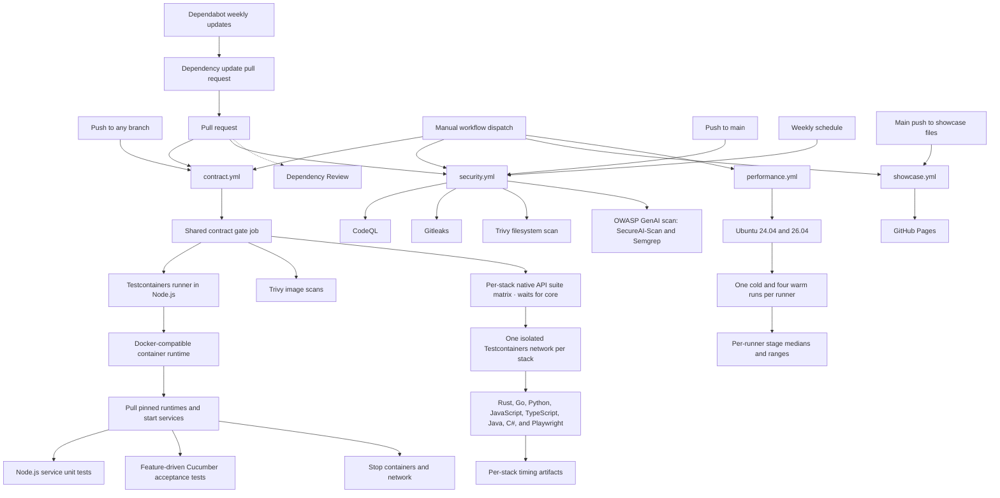

# oas-polycontract

oas-polycontract is a runnable reference template for specification-led API testing. It shows how one contract per interface can guide provider verification, consumer development against a Smart Mock, and native API integration tests. The sample APIs are intentionally small; they demonstrate the workflow, not enterprise-scale coverage.

## Purpose

- Keep one reviewed contract for each API boundary and use it to guide provider verification and consumer development against a provider Smart Mock.
- Validate live behavior with native integration suites. Specmatic verifies the provider and serves a provider-spec mock; Schemathesis covers fuzzing and stateful flows.
- Use Swagger UI and Prism to inspect the Catalog scaffold; use the Postman and Bruno examples with the runnable Product and Order APIs.
- Reduce duplicate specs and overlapping tools to lower maintenance and tooling costs.
- Keep contracts usable across clients, test frameworks, and vendors. One contract owner means less maintenance and more trust.

[Interactive showcase](https://shoman2020.github.io/oas-polycontract/) · [Contracts](https://shoman2020.github.io/oas-polycontract/#contracts) · [Test roles](https://shoman2020.github.io/oas-polycontract/#test-roles) · [Test behavior](https://shoman2020.github.io/oas-polycontract/#test-behavior) · [Pipeline](https://shoman2020.github.io/oas-polycontract/#pipeline) · [Workflows](https://shoman2020.github.io/oas-polycontract/#workflows) · [Performance](https://shoman2020.github.io/oas-polycontract/#performance) · [Roadmap](ROADMAP.md)

## Flow overview

These diagrams render in this README. Open the [interactive showcase](https://shoman2020.github.io/oas-polycontract/) for the full project, pipeline, workflow, and performance maps.

### Contract and test flow



Native suites are code-based API integration tests: they call the running APIs, validate exercised responses with language-specific tools, and assert behavior in each test framework. Specmatic provider verification targets the live Product API. Consumer-side checks run against a Smart Mock generated from the provider OAS, giving consumer teams an early integration target. They do not publish consumer-owned contracts or validate consumer-specific expectations. Schemathesis generates Product fuzz cases and stateful Order flows. Playwright uses APIRequestContext, not browser UI automation.

### CI workflow



## Run

Requires Node.js 26.13.1, npm 12.2.3, and a Docker-compatible container runtime. The repository includes `.nvmrc` for Node.js selection; with nvm, run `nvm use` and install the pinned npm with `npm install --global npm@12.2.3`. Testcontainers for Node.js manages the pipeline.

```sh
bash ./run.sh
```

`run.sh` checks the exact pinned Node.js/npm versions, installs the locked pipeline dependency, and starts an isolated Testcontainers network. It prepares the Node test image with the pinned npm release, verifies a pinned WireMock standalone JAR by SHA-256, then runs shared contract gates and API suites. In CI, Trivy scans the prepared Node image, WireMock image and standalone JAR, and Specmatic image. Contract, fixture, and client source mounts are read-only; dependency downloads and build outputs stay in temporary container directories. Tests cannot rewrite the checked-in OAS. Update a contract through a reviewed source change, then update its compatibility baseline in the same change when the new version is intentional. Use Docker Desktop or Colima on macOS, or Docker Desktop with WSL/Git Bash on Windows. CI uses Ubuntu.

The pipeline stops when a stage fails so dependent checks do not create cascading errors. Its timing report lists later stages as `skipped`, alongside completed and failed stages. Contract CI runs shared gates once, then starts a separate Testcontainers job for each language stack and Playwright. Each job starts its own Product, Order, and WireMock services and publishes a stack-specific timing artifact. Local `bash ./run.sh` runs the full sequence by default; `POLYCONTRACT_PIPELINE_PROFILE=core` and `native` select the corresponding CI profiles. CI runs the shared contract gates once, then starts a separate Testcontainers job for each native language stack and Playwright. Each job starts its own Product, Order, and WireMock services and publishes a stack-specific timing artifact. Local `bash ./run.sh` keeps the full sequential run by default; `POLYCONTRACT_PIPELINE_PROFILE=core` and `native` select the corresponding CI profiles.

Full runs include seven language suites to demonstrate options. The seven language suites and the Specmatic and WireMock integrations are examples with suggested tools, not a required stack. Use this guide to migrate API tests to your team's native language and framework, keeping them in the same repository as the service or consumer. For a focused local run, select a comma-separated subset; JavaScript and Playwright also check consumer flows against the provider Smart Mock:

```sh
POLYCONTRACT_NATIVE_CLIENTS=rust,python bash ./run.sh
```

## Behavior scenarios and test-driven changes

The [Product and Order Gherkin features](clients/features/README.md) define acceptance behavior and scenario data. The API-specific [Cucumber step files](clients/js/bdd/) bind each feature to live service checks. Cucumber runs those features against Product and Order. The [feature-case generator](clients/shared/generate-acceptance-cases.mjs) exports scenario data to [shared JSON](clients/shared/acceptance-cases.json), read by all seven native language suites. Node.js service tests cover the same behavior in isolation and run before API gates. For a behavior change, update a scenario, write a failing unit test, implement the smallest change, then run the focused tests and full pipeline.

## Enterprise adoption

Treat this repository as a pilot template. Before adopting it across teams, adapt these boundaries to the company’s API portfolio and engineering standards:

| Area | Current example | Adoption step |
|---|---|---|
| API coverage | One Product lookup and one in-memory Order lifecycle | Pilot with representative APIs, including authentication, errors, pagination, versioning, and downstream failure modes. |
| Consumer ownership | Provider OAS generates the Smart Mock; this example has no consumer-owned contract | Add a versioned contract per consumer and provider verification when teams need to check their own expectations. |
| Validators | Language validators differ. The Rust and C# adapters translate nullable values, `exclusiveMinimum`, and nested local component-schema references covered by conformance tests; neither claims full OAS 3.0 coverage. C# rejects external and unsupported references before schema resolution. | Agree a supported OAS feature matrix and test each language against it. Add coverage for constructs such as `allOf`, `anyOf`, and discriminators before relying on them. Use the shared Spectral, Specmatic, and Schemathesis gates for contract-wide checks. |
| Runtime state | Order data is in memory, scoped to one app instance, and lost on restart | Use isolated test data and a service-backed store for tests that need persistence, parallel environments, or multi-instance behavior. |
| Runtime versions | CI tests one centrally pinned toolchain | Align pins with approved company versions and add compatibility jobs for the runtimes teams support. |
| CI cost | The full run pulls pinned runtime images and runs all client suites; client dependencies install into temporary containers | Measure the full workflow in the target CI environment before making it a required check; use the CSV stage timings to tune caching, parallelism, and coverage. |
| Merge governance | Workflows report checks; `main` does not currently require them | Require the contract and security checks in repository rules before using the template as a merge gate. |

The Order service remains a stateful test fixture, not a production implementation. It uses random UUIDs to avoid collisions between concurrent app instances, and tests confirm that each app instance has isolated data. Its in-memory store does not provide persistence or coordination between replicas, so a request routed to another replica may return 404. The pinned toolchain is a tested reference set, not a promise of compatibility with every company runtime.

For a multi-team rollout, assign an accountable owner to each API boundary instead of routing all contract changes through a central test team. Providers version and verify their specifications; consumers maintain separate expectations when their integrations need them verified. Share approved templates and CI policies while letting each service choose its test environment and supported runtime matrix.

## Contracts

Specifications are reviewed source files and read-only pipeline inputs. Tests, generators, and client suites must not edit them. In separate provider and consumer repositories, publish an immutable OAS artifact or commit tag and pin the same version in both projects. Change the specification through a reviewed source update; update the matching compatibility baseline only as part of an intentional contract release.

| Boundary | Contract | Implementation and checks |
|---|---|---|
| Product Catalog | [Root OAS](openapi/openapi.yaml) | Separate design scaffold; its full Product schema includes a name; Spectral, Swagger UI, Prism |
| Product API | [Demo OAS](demo/openapi.yaml) | Separate runnable boundary; returns an availability projection (`sku`, `available`); Node.js, Specmatic, Schemathesis, seven languages, Playwright |
| Order API | [Stateful OAS](demo/stateful/openapi.yaml) | In-memory Node.js; stateful Schemathesis and seven native suites |
| Inventory dependency | [Downstream OAS](demo/downstream/openapi.yaml) | WireMock mappings, Specmatic, downstream integration |
| Product events | [AsyncAPI examples](contracts/events/) | WebSocket and Kafka message contracts; lint only |

The Catalog scaffold and Product API intentionally model different boundaries, not competing schemas for one provider. The demo response is an inventory-backed availability projection, while the Catalog schema describes the fuller resource. OpenAPI describes HTTP operations and payloads such as JSON and XML. AsyncAPI describes event messages over WebSocket and Kafka. JSON, YAML, and XML describe document or payload formats; the contract separately defines the interface and transport. Event examples are linted; no event provider or broker is included, so the repository has no event runtime test coverage.

## Architecture

| Layer | Responsibility | Source |
|---|---|---|
| Specifications | Define API boundaries, examples, and accepted compatibility snapshots | `openapi/`, `demo/`, `contracts/events/`, `contracts/baselines/` |
| Demo services | Implement Product, Order, and WireMock-backed Inventory examples | `demo/` |
| Native clients | Encapsulate HTTP calls; language validators check exercised responses and tests assert behavior | `clients/`, `clients/features/`, `clients/shared/` |
| Orchestration | Full local, shared core, and per-stack native profiles use one Testcontainers builder with explicit service and task readiness | `pipeline/run.mjs`, `pipeline/client-suite.sh`, `.github/workflows/contract.yml` |
| Shared configuration | Parse and validate required runtime pins before container startup | `pipeline/config.mjs`, `.github/versions.env` |
| Quality checks | Validate contracts, project wiring, security, and dependencies | `gates/`, `evals/`, `.github/workflows/` |

The pipeline runner is the composition root: it starts services and calls the specialized gates and client suites. Each language keeps its API client and assertions in that language's native test stack. See the [client guide](clients/README.md) for the implementation map.

## Testing model and terminology

Use these terms consistently across the contracts, tests, and pipeline:

| Term | Meaning in this project |
|---|---|
| OAS | OpenAPI Specification; describes HTTP operations and request/response data. |
| AsyncAPI | Specification for event-driven interfaces such as Kafka and WebSocket messages. |
| Specification | Machine-readable interface definition, such as OAS or AsyncAPI. |
| Contract | The agreed interface behavior expressed by its specification. |
| Provider contract verification | Specmatic sends contract-derived requests to the running Product API. |
| Consumer development against a provider Smart Mock | JavaScript and Playwright exercise responses generated from the provider OAS; consumer-owned expectations are not part of this example. |
| Smart Mock | Specmatic server that returns responses defined by the provider's contract and examples. |
| API integration test | A native suite calls a running application, validates declared operations against OAS, then asserts behavior. Undeclared methods are checked for HTTP 405 and `Allow`. |
| Schema validation | Checks response shape and declared media type; it does not replace behavior assertions. |
| Stateless fuzzing | Schemathesis generates independent Product requests from the OAS. |
| Stateful testing | Linked operations share returned data; Order tests follow create, read, confirm, delete, then 404. |
| Quality gate | A CI check that reports whether a change meets a stated requirement; merge enforcement is configured separately. |
| BDD acceptance test | Cucumber uses API-specific steps for the shared Product and Order features in `clients/features/`; declared operations are checked against OAS. |
| TDD unit test | Node.js service tests check API behavior in isolation; add the failing test before changing implementation. |

Provider verification and consumer development against a Smart Mock share the Product OAS but target different systems. The mock offers consumers an early integration target based on the provider’s declared interface. Consumer-owned expectations are not represented here. API integration suites exercise live services. Cucumber runs Product and Order acceptance scenarios against the live APIs; Rust, Go, Python, JavaScript, TypeScript, Java, and C# suites use the same scenario data. Node.js unit tests check service behavior in isolation.

### Contract-based testing

| Role | Implementation | Target |
|---|---|---|
| Provider | Specmatic provider verification | Live Product API, app:8080 |
| Consumer development | JavaScript and Playwright checks | Specmatic Smart Mock generated from provider OAS, `specmatic-mock:9000` |

### API integration testing

| Test | Source | Target |
|---|---|---|
| Product API integration test | Seven native suites and Playwright | Live Product API |
| Stateful API integration test | Seven native suites | Live Order API; create, read, confirm, delete, then 404 |
| Downstream service integration test | WireMock integration suite | Product API and WireMock request journal |

### Manual debugging and collection migration

The [Postman and Bruno collections](legacy/) follow the Product and Order OAS for interactive requests and migration of older request workflows. See [legacy/README.md](legacy/README.md) for import and local-service instructions.

See the [client guide](clients/README.md) for test entry points, validators, migration, and sample output.

## Fuzzing and mock data

Stateless Schemathesis fuzzing sends independent Product API requests. Only the unavailable-inventory lookup allows the documented 502. Stateful Schemathesis follows linked Order operations and reuses returned IDs; each Order app instance starts with empty, in-memory state.

Specmatic mock data uses OAS examples, fixtures in `demo/openapi_examples`, and values in `demo/openapi_dictionary.yaml`. Repository evaluations check fixture responses and dictionary fallbacks. Keep sample data deterministic and review changes before committing.

## Quality gates

| Gate | Check | Workflow |
|---|---|---|
| Contract quality | Spectral lint and OAS compatibility | `contract.yml` |
| API behavior | Specmatic provider verification, failing canaries, 404/400/409/502 assertions, WireMock, Schemathesis, and native integration suites | `contract.yml` |
| Project consistency | Repository evaluations check links, structure, test roles, workflows, and roadmap | `contract.yml` |
| Source and dependencies | CodeQL, Gitleaks, Trivy filesystem scan, Dependency Review, and Dependabot | `security.yml` |
| Container and runtime artifacts | Trivy scans the prepared Node image, Java runtime, WireMock JAR, and Specmatic | `contract.yml` |
| GenAI code | SecureAI-Scan scans repository source; manual positive controls demonstrate SecureAI-Scan and Semgrep rules | `security.yml` |

Dependabot checks package manifests weekly. Contract CI runs on pushes, pull requests, and manual dispatch. Security CI runs on pushes to `main`, pull requests, a weekly schedule, and manual dispatch. See the [interactive workflow map](https://shoman2020.github.io/oas-polycontract/#workflows).

The [OWASP SecureAI-Scan](https://genai.owasp.org/solution/secureai-scan/) gate scans repository source for AI, LLM, and MCP risks. This project has no runtime AI or MCP integration. Manual `workflow_dispatch` runs can also execute isolated positive controls: the [SecureAI example](gates/security/run-genai-example.mjs) creates a temporary TypeScript chat handler with user input in a system prompt, checks for the expected high `AI001` finding, and saves its SARIF artifact. The temporary source is removed before the repository scan. Manual-only fixtures keep demonstration code out of routine pull-request scans.

The verified example result is `HIGH AI001 — Prompt injection via user input`. SecureAI-Scan exits with code 1 at `--fail-on high`; the wrapper reports success only after confirming the SARIF contains `AI001`.

Run the positive-control example locally from Bash after sourcing the pinned version:

```sh
source .github/versions.env
export SECUREAI_SCAN_VERSION
node gates/security/run-genai-example.mjs
```

The project scan remains a separate gate and uploads its SARIF to GitHub Code Scanning. The demo's expected finding is kept as an artifact so it is visible without appearing as a repository vulnerability.

SecureAI-Scan provides AI and MCP source rules for JavaScript, TypeScript, and Python. Run a focused scan when those folders contain AI or MCP code:

```sh
source .github/versions.env
npx --yes "secureai-scan@$SECUREAI_SCAN_VERSION" scan clients/js --fail-on high
npx --yes "secureai-scan@$SECUREAI_SCAN_VERSION" scan clients/ts --fail-on high
npx --yes "secureai-scan@$SECUREAI_SCAN_VERSION" scan clients/python --fail-on high
```

For Rust, Go, Java, and C#, manual `workflow_dispatch` runs can execute project-owned Semgrep taint rules against temporary prompt-injection examples. Each rule checks whether request prompt data flows into a system-message constructor. These focused examples are not a universal GenAI ruleset; adapt source and sink patterns to the AI SDK and request model in your application. Semgrep's language support includes all four languages, and its taint rules define sources and sinks explicitly ([language support](https://semgrep.dev/products/integrations/), [taint analysis](https://semgrep.dev/docs/writing-rules/data-flow/taint-mode/)).

| Language | GenAI-specific check | General source analysis |
|---|---|---|
| JavaScript | SecureAI-Scan `scan clients/js --fail-on high` | CodeQL `javascript-typescript` |
| TypeScript | SecureAI-Scan `scan clients/ts --fail-on high` | CodeQL `javascript-typescript` |
| Python | SecureAI-Scan `scan clients/python --fail-on high` | CodeQL `python` |
| Rust | Semgrep `genai-untrusted-system-prompt-rust` | CodeQL `rust` |
| Go | Semgrep `genai-untrusted-system-prompt-go` | CodeQL `go` |
| Java | Semgrep `genai-untrusted-system-prompt-java` | CodeQL `java-kotlin` |
| C# | Semgrep `genai-untrusted-system-prompt-csharp` | CodeQL `csharp` |

The Rust, Go, Java, and C# examples are generated temporarily by [run-language-genai-example.mjs](gates/security/run-language-genai-example.mjs). A manual workflow verifies four findings and stores the SARIF report as the `semgrep-genai-language-examples` artifact. The custom rules are in [semgrep-genai.yml](gates/security/semgrep-genai.yml). Run them locally with Docker and the pinned Semgrep image:

```sh
source .github/versions.env
export SEMGREP_VERSION
node gates/security/run-language-genai-example.mjs
```

SecureAI-Scan and Semgrep versions are in `.github/versions.env`.

## Performance

Each contract run reports stage timings and uploads a CSV artifact. The last five-sample baseline measured **304s cold** and **201s warm median** (200–205s range), with cached build time falling from 91s to 2s. This baseline predates the Testcontainers migration; it is not comparable to current runs or an SLA. Run the manual performance benchmark on Ubuntu 24.04/26.04 and record the new results before making performance claims. See the [previous baseline](https://github.com/shoman2020/oas-polycontract/actions/runs/44146642941), [performance view](https://shoman2020.github.io/oas-polycontract/#performance), and [Phase 12](ROADMAP.md#phase-12--performance-baseline).

## Project structure

| Path | Purpose |
|---|---|
| openapi/ | Root Catalog design scaffold |
| contracts/baselines/ | Reviewed compatibility snapshots for Product, Order, and Inventory providers |
| contracts/events/ | AsyncAPI examples |
| demo/ | Product, Order, Inventory, WireMock, and mock data |
| legacy/ | Postman and Bruno collections adapted from project contracts |
| clients/ | Rust, Go, Python, JS, TS, Java, C#, Playwright |
| clients/rust/Cargo.lock; clients/go/go.sum; clients/csharp/packages.lock.json | Rust, Go, and .NET dependency locks |
| gates/ | Contract lint, compatibility checks, and security examples |
| evals/ | Documentation, roles, and pipeline checks |
| clients/features/ | Product and Order Gherkin acceptance scenarios with shared JSON data |
| clients/shared/ | Generated acceptance case data and its feature-data exporter |
| clients/js/bdd/ | Shared Cucumber support and API-specific step definitions |
| docs/project-flow.html | Interactive showcase source, published on GitHub Pages |
| .github/workflows/ | Contract, security, performance, and showcase automation |
| .github/versions.env | Central tool and runtime version pins |
| pipeline/run.mjs; pipeline/client-suite.sh; run.sh | Testcontainers orchestration, native suite entry point, runtime-pin parser and tests, local/CI entry point |

## Contribute

Have a feature idea or found a bug? [Open an issue](https://github.com/shoman2020/oas-polycontract/issues). Include reproduction steps, expected and actual results, and useful logs. See [CONTRIBUTING.md](CONTRIBUTING.md).
