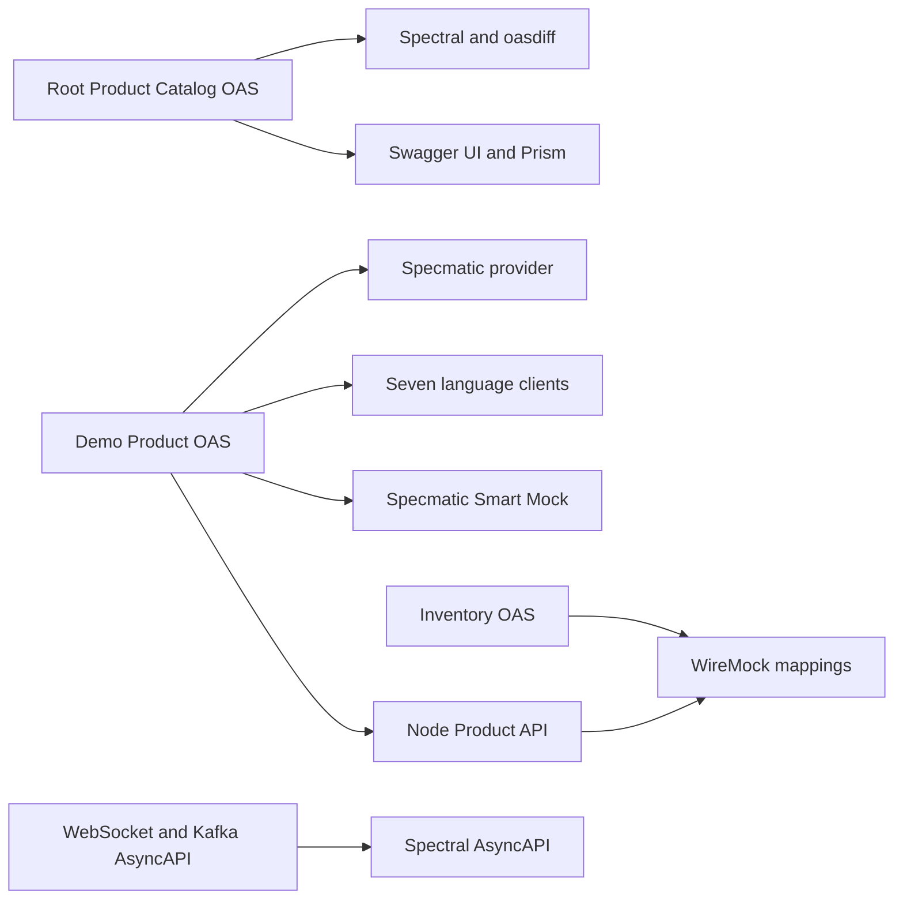

# oas-polycontract

One hand-edited contract per API boundary. Native test suites validate live HTTP responses against that contract, while Specmatic checks provider and consumer behavior. The same command runs the examples locally and in CI.

## Quick start

Requirements: Docker Engine and Docker Compose. From the repository root:

```sh
bash ./run.sh
```

On macOS, use Docker Desktop or Colima with Docker and Compose installed. Windows users can run it through WSL or Git Bash. The pipeline lints all OpenAPI contracts, checks the root compatibility baseline, builds the demo and seven native clients, verifies WireMock, runs Specmatic provider/downstream tests, fuzzes the running demo, validates each response against the demo OAS, and checks Smart Mock examples and dictionary fallbacks.

GitHub Actions runs the same pipeline on Ubuntu. macOS is supported for local runs and is not a CI runner. Security workflows run CodeQL, Gitleaks, Trivy, and pull request dependency review. Runtime, image, and scanner versions are pinned in [`.github/versions.env`](.github/versions.env); Dependabot checks language package manifests weekly.

## Project landscape

Each API boundary has its own hand-edited contract. Tests, mocks, and debug views consume that contract; they do not become competing specifications.

| Boundary | Contract | Implementation or consumer | Checks |
|---|---|---|---|
| Product Catalog scaffold | [`openapi/openapi.yaml`](openapi/openapi.yaml) | No provider is included yet | Spectral, root baseline compatibility, Swagger UI, Prism |
| Runnable Product API | [`demo/openapi.yaml`](demo/openapi.yaml) | Node.js provider in `demo/app/` | Spectral, Specmatic provider, Schemathesis, seven native clients, Smart Mock |
| Inventory dependency | [`demo/downstream/openapi.yaml`](demo/downstream/openapi.yaml) | WireMock mappings in `demo/downstream/wiremock/` | Specmatic downstream validation and app integration assertions |
| Product events | `contracts/events/*.asyncapi.yaml` | No broker or event provider is included | AsyncAPI Spectral ruleset |

`run.sh` coordinates the applicable gates and examples through Compose. GitHub Actions calls the same entry point on Ubuntu. The root Catalog contract is a design scaffold; the demo Product API is the live service used by the client examples. Keep those roles distinct when adding tests.



## Contract formats and protocols

Choose the contract standard by interface. `.json`, `.yaml`, and `.yml` are document encodings; they do not identify the protocol. The contract content type and transport are separate choices.

| Interface | Contract standard | Payload or wire formats |
|---|---|---|
| HTTP APIs | OpenAPI (OAS) | JSON (`application/json`), XML (`application/xml`), form and multipart data, text, and binary media types as described per operation. |
| WebSockets and event-driven APIs | AsyncAPI | JSON, XML, Avro, or Protobuf messages over WebSocket, Kafka, MQTT, AMQP, NATS, and supported brokers. |
| gRPC | Protocol Buffers service definitions | Protobuf messages over HTTP/2. |
| GraphQL | GraphQL SDL | GraphQL operations over HTTP; subscriptions may use WebSocket or SSE transports. |
| SOAP | WSDL | XML messages, commonly over HTTP. |

OpenAPI describes HTTP request/response APIs; it does not define Kafka topics or WebSocket message flows. Use one canonical contract per interface, validate it with tools that understand that standard, and link related contracts when a service exposes HTTP and event interfaces. Do not force every protocol into an OpenAPI file.

[`contracts/events/`](contracts/events/) contains linted AsyncAPI examples for WebSocket and Kafka. They document message shapes only; no WebSocket server or Kafka broker is included in this demo.

## Language-native integration tests

The migration path is: inventory existing requests and assertions, map operations and schemas to OAS, hand-review the contract, then port only business assertions into the selected language suite. The OAS remains the shared validation source. Runtime response validators enforce status, media type, and schema before test code checks behavior.

The runnable suites live in [`clients/`](clients/). Each makes a real HTTP request to the demo API, validates the status, media type, and response body against `demo/openapi.yaml`, then keeps one business assertion in test code. The root Product Catalog contract is a separate scaffold and currently has no service implementation; root-level tests do not target it.

| Language | Native test stack | OAS response validator |
|---|---|---|
| Rust | `cargo test` + `reqwest` | `jsonschema` with the response schema resolved from the OAS |
| Go | `testing` + `net/http` | `kin-openapi` request routing and `ValidateResponse` |
| Python | `pytest` + `requests` | `openapi-core` Requests adapters |
| JavaScript | Node `node:test` + `fetch` | `@oaverify/core` and YAML loader |
| TypeScript | Vitest + `fetch` | `@oaverify/core` and YAML loader; `tsc` runs first |
| Java | JUnit + REST Assured | Atlassian OpenAPI Request Validator filter |
| C# | xUnit + `HttpClient` | `NJsonSchema` using the response schema read from OAS YAML |

The JavaScript suite also runs against Specmatic's Smart Mock as a consumer example. The test keeps its business assertion in JavaScript; the validator confirms the response contract. Migration notes and representative output are in [`clients/README.md`](clients/README.md).

## Mock data patterns

The demo's Specmatic mock has three data sources, ordered by intent:

1. **Exact scenarios:** operation examples in [`demo/openapi.yaml`](demo/openapi.yaml) describe common responses. Use these when a response must be fixed and visible with the API contract.
2. **Named datasets:** files under [`demo/openapi_examples/`](demo/openapi_examples/) pair a concrete request with its deterministic response. The `vip-sku` request always returns the checked-in VIP response.
3. **Domain-shaped fallback:** [`demo/openapi_dictionary.yaml`](demo/openapi_dictionary.yaml) supplies meaningful values when the mock has no matching example. Dictionary lists are sampled pseudo-randomly, so don't use them when a test needs a specific response.

`bash ./run.sh` starts the Smart Mock and asserts the inline example, external VIP example, and dictionary-backed fallback. To keep the mock running for manual exploration, use `docker compose --profile mock up specmatic-mock`; it listens on `http://localhost:9000`.

AI can help draft realistic, varied mock datasets from schemas and approved domain vocabulary. Review and validate generated data, remove secrets and personal data, then commit fixtures or dictionaries. Do not make live AI generation part of the contract or a deterministic CI test. See [Specmatic dictionaries](https://docs.specmatic.io/features/dictionary.html), [external examples](https://docs.specmatic.io/features/external_examples.html), and [service virtualization](https://docs.specmatic.io/spec_driven_api_development/service_virtualization).

## Project structure

```text
oas-polycontract/
|-- openapi/
|   |-- openapi.yaml                 # Root Product Catalog OAS (hand-edited)
|   `-- openapi.base.yaml            # Compatibility baseline
|-- contracts/events/                # AsyncAPI WebSocket and Kafka examples
|-- demo/
|   |-- openapi.yaml                 # Runnable Product API contract
|   |-- openapi_examples/            # Deterministic Specmatic request/response data
|   |-- openapi_dictionary.yaml      # Domain-shaped fallback values for Smart Mock
|   |-- app/                         # Node provider and integration assertions
|   |-- downstream/
|   |   |-- openapi.yaml             # Inventory dependency contract
|   |   `-- wiremock/                # Dependency stubs checked against that contract
|   `-- wiremock/                    # Patched WireMock container definition
|-- clients/
|   |-- rust/
|   |-- go/
|   |-- python/
|   |-- js/
|   |-- ts/
|   |-- java/
|   |-- csharp/                      # Native integration tests
|   `-- README.md                    # Migration steps and sample test output
|-- gates/
|   |-- lint/                        # OpenAPI and AsyncAPI Spectral rules
|   `-- breaking-change/             # Root OAS compatibility check
|-- .github/
|   |-- workflows/                  # Contract pipeline and security scans
|   |-- security/                    # Specmatic OpenVEX assessment
|   `-- versions.env                 # Runtime, tool, image, and scanner pins
|-- docker-compose.yml               # Demo services, clients, and optional profiles
`-- run.sh                           # Local and CI pipeline entry point
```

The `debug` profile serves Swagger UI on `http://localhost:8082` and Prism on `http://localhost:4010` from the root contract. The `mock` profile starts Specmatic Smart Mock on `http://localhost:9000`. Edit OAS server URLs for deployed environments. These profiles support manual exploration and do not replace the contract test pipeline.

## Contribute

Have a feature idea or found a bug? [Open an issue](https://github.com/shoman2020/oas-polycontract/issues). For bugs, include reproduction steps, expected and actual results, and relevant logs or environment details. See [`CONTRIBUTING.md`](CONTRIBUTING.md) before changing contracts.
