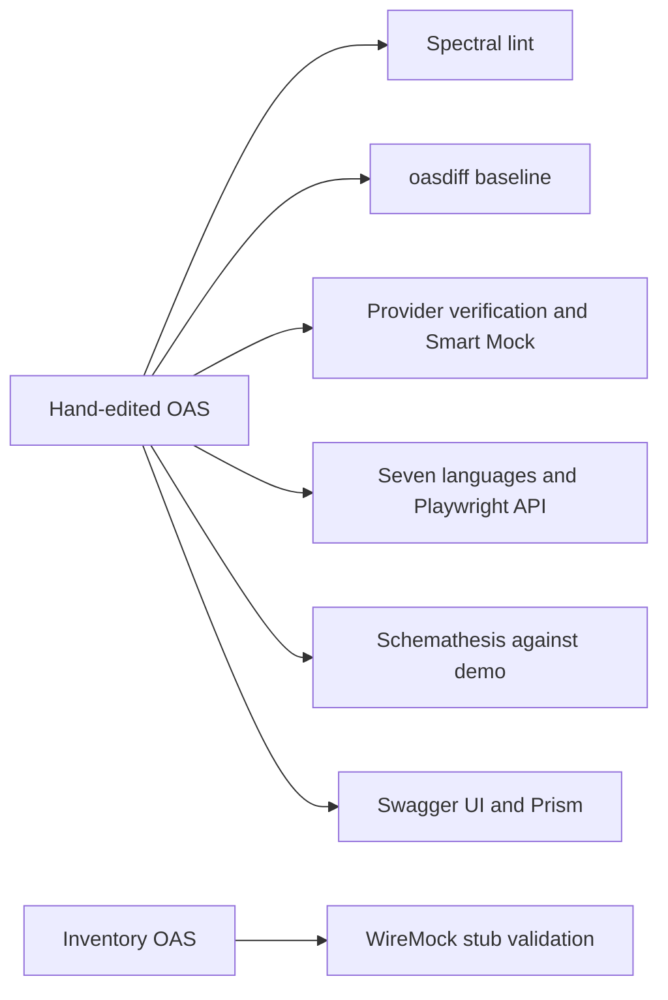

# oas-polycontract roadmap

One hand-edited contract per API boundary. Native tests and contract tools read it; generated views never become another source of truth.

## Guiding rule

One role owns the contract. Clear ownership means less maintenance and more trust. Providers and consumers use the same contract revision. WireMock mappings describe a downstream dependency and are checked against that dependency's contract.

## Status — 16 November 2026

| Area | Implementation | Verification or remaining work |
|---|---|---|
| Runnable demo | Product API, isolated linked Order API, inventory dependency, WireMock, Specmatic provider and downstream tests | Run 440409 passed both Schemathesis phases, WireMock, Specmatic, and the native suites through Java. C# compilation then failed because the validator treated a generic YAML node as a mapping; cast and guard added. |
| Governance | Spectral for OAS and AsyncAPI, oasdiff against the root baseline, stateless and stateful Schemathesis | Both Schemathesis phases passed in run 440409; linked stateful operations completed without failures. The root Product Catalog contract has no provider implementation. |
| Language and API test clients | Rust, Go, Python, JavaScript, TypeScript, Java, and C# validate Product API and Order API responses; Playwright covers Product API | Run 440409 passed Rust, Go, Python, JavaScript, TypeScript, Playwright provider, and Java with stateful flows; C# failed at compile time. The validator cast is corrected and test cancellation tokens are now forwarded. |
| Provider and consumer contract roles | Specmatic provider verification targets the running app; JavaScript and Playwright consumer suites target the Specmatic Smart Mock | The shared provider OAS drives both examples. This is consumer-side development against a contract-derived mock, not a separately published consumer-owned CDC artifact. Runtime verification awaits CI. |
| Protocol coverage | AsyncAPI examples for WebSocket and Kafka, with a separate Spectral ruleset | Contract examples only; no event service or broker is part of the demo. |
| Debug layer | Optional Swagger UI and Prism Compose services use the root contract | Local profile exists; environment-specific host URLs still need deployment configuration. |
| CI and security | Ubuntu contract workflow; CodeQL, Gitleaks, Trivy, Dependency Review, and Dependabot | Contract run [44040993712](https://github.com/shoman2020/oas-polycontract/actions/runs/44040993712) passed all three image scans. Both stateful and stateless checks passed; C# stopped compilation on a YAML node type issue, now fixed. |
| Dependency reproducibility | Direct package versions and container/tool versions are pinned | Most language projects do not yet commit transitive lockfiles. Add native lockfiles after the first green pipeline run, then enforce locked installs. |
| Migration | No legacy Postman or Bruno collection was supplied | Phase 5 is not applicable unless one is provided. |
| Scaffolder | Not implemented | Phase 9 remains open until the end-to-end pipeline is stable. |
| MCP | Design notes only | Optional; keep outside the contract and test source of truth. |

## Contract flow



The repository has two distinct HTTP contracts. `openapi/openapi.yaml` is the root Product Catalog scaffold and its baseline; it has no server. `demo/openapi.yaml` is exercised by the demo app, seven language-native suites, and Playwright API tests. `demo/downstream/openapi.yaml` describes the app's WireMock-backed inventory dependency.

Specmatic roles are separate: `specmatic-provider` runs contract-derived requests against the healthy app; `specmatic-mock` serves the same OAS for JavaScript and Playwright consumer-side tests. Those client suites also run against the live app as API integration tests. The mock-backed example demonstrates consumer development against a shared provider contract, not a separate consumer-owned CDC contract.

## Phases

### Phase 0 — Scaffold

- [x] Repository layout, ownership, contribution guidance, and quick start.

### Phase 1 — Contract source

- [x] Design-first root Product Catalog OAS and pinned baseline.
- [x] Keep the runnable demo's Product API and Inventory API as separate boundaries.
- [ ] If the root contract later becomes code-first, regenerate its candidate spec before compatibility checks.

### Phase 2 — Governance

- [x] Lint root, demo, and downstream OpenAPI contracts with Spectral.
- [x] Lint WebSocket and Kafka AsyncAPI examples with Spectral.
- [x] Compare the root contract with its committed baseline using oasdiff.
- [x] Run Schemathesis against the live demo service.
- [x] Add a separate stateful Order API with linked OAS operations and run Schemathesis' stateful phase against it.
- [x] Test the demo provider and WireMock dependency with Specmatic, including deterministic 404 and 502 examples.
- [x] Return a declared `405 Method Not Allowed` with `Allow: GET` for unsupported methods on known routes; add the response to the demo OAS.
- [ ] Run the expanded gates in CI and configure branch protection to require them.
- [ ] Keep Specmatic behavioral backward-compatibility checking optional; it overlaps the structural oasdiff gate and is not needed for this single baseline.
- [ ] Add a root provider check only if a root API implementation is created.

### Phase 3 — Language-native clients

- [x] Add runtime OAS response validation and a business assertion in Rust (`reqwest` + `jsonschema`), Go (`net/http` + `kin-openapi`), Python (`pytest` + `openapi-core`), JavaScript (`node:test` + `@oaverify`), TypeScript (Vitest + `@oaverify`), Java (JUnit + REST Assured validator), and C# (xUnit + `NJsonSchema`).
- [x] Read the committed `demo/openapi.yaml` directly; do not maintain duplicate schemas or treat generated types as wire validation.
- [x] Encapsulate HTTP setup in idiomatic API client objects for all seven languages; keep OAS validation and business assertions distinct where the native framework supports it.
- [x] Add a JavaScript consumer example against the Smart Mock.
- [x] Add Playwright APIRequestContext provider integration and Smart Mock consumer examples; no browser binary is needed for API-only tests.
- [x] Add create/read/confirm/delete/post-delete-404 integration flows with OAS response validation in all seven native languages.
- [x] Wire the separate stateful contract and provider into the seven language test containers.
- [x] Keep provider verification, consumer-side mock tests, and live-server API integration suites distinct in the README and runnable examples.
- [x] Document how to port requests and assertions from Postman or Bruno in [`clients/README.md`](clients/README.md).
- [ ] Confirm the stateful and Product API scenarios pass in all seven language suites and both Playwright targets pass in the expanded pipeline.

### Protocol scope

- [x] Document file encodings separately from transports and payload media types. OAS covers HTTP with JSON, XML, text, form, multipart, and binary media types when declared.
- [x] Add AsyncAPI 2.6 examples for WebSocket and Kafka and lint them.
- [ ] Add a runtime and compatibility gate for an event protocol when the project includes an event provider or broker.
- [ ] Add gRPC, GraphQL, or SOAP examples only alongside an implementation to exercise.

### Mock data

- [x] Keep common examples in OAS, deterministic request-specific fixtures in `demo/openapi_examples/`, and domain-shaped fallback values in `demo/openapi_dictionary.yaml`.
- [x] Keep AI-assisted fixture generation offline: review, schema-validate, and commit outputs; CI and mock startup do not call a model.
- [x] Validate external examples and add assertions for inline, external, and dictionary responses.
- [ ] Confirm mock-profile behavior in CI.

### Phase 4 — Debugging layer

- [x] Add optional Swagger UI and Prism profiles sourced from the root OAS.
- [x] Keep them for manual exploration; contract tests remain the CI automation source.
- [ ] Configure real dev, staging, and production base URLs when those environments are available.
- [ ] Generate a Bruno debugging collection only if maintainers request one; no legacy collection exists today.

### Phase 5 — Legacy migration

Not applicable with the supplied project: no legacy collection was provided. If one is added, inventory every request and assertion, migrate shape to OAS, move setup to native fixtures, remove duplicate schema assertions, and port business rules once.

### Phase 6 — Compose and local run

- [x] Parameterize runtime and tool image versions in `.github/versions.env`; pin language dependencies in native manifests.
- [x] Compose the demo, seven language suites, Playwright provider and consumer tests, governance checks, fuzzing, and mock assertions.
- [x] Have `run.sh` execute the full applicable suite and always tear down containers on success or failure.
- [x] Keep GitHub Actions on Ubuntu; support Docker Desktop or Colima on macOS for local runs.
- [ ] Confirm the full clean-checkout run in CI, including the stateful provider, Schemathesis phase, and all seven native lifecycle suites.

### Phase 7 — CI and security

- [x] Run `bash ./run.sh` in the Ubuntu contract workflow.
- [x] Keep CodeQL, Gitleaks, Trivy, Dependency Review, and weekly Dependabot checks.
- [x] Cover Rust, Go, Python, JavaScript/TypeScript, Java, C#, and GitHub Actions with CodeQL; use the language-appropriate build mode.
- [x] Apply Specmatic's upstream OpenVEX assessment through the Trivy config for its bundled Guava finding.
- [x] Confirm the updated Trivy scan accepts the VEX disposition and passes on Specmatic 2.56.3 (contract run 43933329023).
- [ ] Review the new workflow results and set required status checks in GitHub repository settings.

### Phase 8 — Docs

- [x] Consolidate the README around the contract flow, runnable example, native suites, protocol scope, mock data, and contribution path.
- [x] Document the example output and migration workflow.
- [x] Keep roadmap status aligned with implementation and verification state.
- [x] Add the animated project flow, application-server test topology, stateless/stateful guidance, and a measured CI performance snapshot.

### Phase 9 — Reusable scaffolder

- [ ] Build the optional `create-polycontract` CLI only after the new pipeline is stable.
- [ ] Support `init` and additive `add` commands, non-interactive flags, safe prompts, and a manifest that prevents overwriting hand-edited files.
- [ ] Generate only selected clients, gates, debug services, and CI configuration from maintained templates.

## Remaining work and acceptance criteria

These are the current gaps, in execution order. “Implemented” means files and wiring exist; it does not imply a successful CI run.

| Priority | Gap | Status | Acceptance signal |
|---|---|---|---|
| P0 | Run the expanded contract and security workflows on this implementation | In progress; run 44040993712 passed WireMock, Specmatic, both Schemathesis phases, Rust, Go, Python, JavaScript, TypeScript, Playwright provider, and Java. C# had a compile-time mapping error. | All applicable contract jobs and image/filesystem scans pass; verify C#, Playwright consumer, and the complete pipeline, then record a full green run. |
| P1 | Make language dependency installs reproducible | Needed | Commit JS/TS package locks, `Cargo.lock`, Go module sums, a hash-locked Python requirements file, and NuGet lock files; lock Maven dependency resolution. Use lock-enforcing installs in the container builds. |
| P1 | Require contract and security checks before merge | Repository configuration needed | GitHub branch protection requires the named checks. This setting is managed outside this repository. |
| P2 | Decide whether the root Product Catalog OAS remains contract-only | Decision needed | If it stays a scaffold, keep provider checks on the demo OAS. If a root provider is added, add provider and client examples against the root contract. |
| Conditional | Exercise event protocols at runtime | Not applicable yet | Add a WebSocket or Kafka provider/broker and contract tests when the project includes one. The current AsyncAPI files are linted examples only. |
| Conditional | Configure deployed debug URLs | Environment details needed | Add the real dev, staging, and production endpoints when those environments exist. |
| Conditional | Migrate legacy requests and assertions | Not applicable yet | Inventory a supplied Postman or Bruno collection, move request shape to OAS, and port genuine business rules to one native suite. |
| Later | Build the optional `create-polycontract` CLI | Deferred until P0 and P1 are complete | `init` and additive `add` generate a selected starter that passes this pipeline without overwriting hand-edited files. |
| Optional | Add MCP support | Design only | Add it only if it wraps checked-in commands without creating another contract or test source of truth. |

## Progress log

| Date | Change | Status |
|---|---|---|
| 16 Nov 2026 | Added seven native HTTP client suites, Smart Mock assertions, WebSocket and Kafka AsyncAPI examples, security workflows, and full Compose wiring. | Implemented; CI verification pending. |
| 16 Nov 2026 | Expanded the README with contract boundaries, pipeline flow, and a repository tree. | Done. |
| 16 Nov 2026 | Added an ordered gap register and acceptance signals for CI verification, dependency locks, branch protection, and conditional phases. | Done; open items remain listed above. |
| 16 Nov 2026 | Expanded CodeQL to all seven client languages and GitHub Actions, with separate build-mode settings. | Implemented; workflow results are pending. |
| 16 Nov 2026 | Reviewed contract run [43884547902](https://github.com/shoman2020/oas-polycontract/actions/runs/43884547902): the app and WireMock image scans passed, while Specmatic's bundled Guava finding failed the scan because the VEX config was not passed. | Added the `trivy-config` input to the contract workflow; the revised scan still needs a run. |
| 16 Nov 2026 | The expanded filesystem scan in security run [43931893077](https://github.com/shoman2020/oas-polycontract/actions/runs/43931893077) flagged all seven client test images for running as root. | Added dedicated non-root users and writable test directories to the seven client images. Rerun the scan to confirm. |
| 16 Nov 2026 | The contract build showed that the .NET runtime patch version is not an SDK image tag; Specmatic's scan loaded VEX but reported the CVE because its name used a GHSA alias. | Updated the SDK pin to 10.0.404 and normalized the VEX vulnerability name to CVE-2026-102554. The next CI run will verify both fixes. |
| 16 Nov 2026 | Security run [43933329040](https://github.com/shoman2020/oas-polycontract/actions/runs/43933329040) passed. Contract run [43933329023](https://github.com/shoman2020/oas-polycontract/actions/runs/43933329023) passed all three image scans, including the Specmatic VEX disposition, but could not find `maven:3.10.1-eclipse-temurin-25`. | Set `MAVEN_VERSION=3.10.0`, the current published Maven image tag compatible with Java 25. Re-run the contract workflow to exercise builds and contract checks. |
| 16 Nov 2026 | Contract run [43934287219](https://github.com/shoman2020/oas-polycontract/actions/runs/43934287219) used the corrected Maven image and reached the C# image build, where `useradd` conflicted with the .NET SDK image's built-in `app` account. | Removed duplicate account creation; the C# test image now uses Microsoft's built-in non-root account. Re-run the contract workflow. |
| 16 Nov 2026 | Contract run [43935112208](https://github.com/shoman2020/oas-polycontract/actions/runs/43935112208) passed Maven and C# image builds, then failed Rust dependency resolution because `reqwest` 0.13.4 removed the `rustls-tls` feature. | Pinned the current `reqwest` 0.13.5 and switched to its `rustls` feature. Re-run the contract workflow. |
| 16 Nov 2026 | Contract run [43935878603](https://github.com/shoman2020/oas-polycontract/actions/runs/43935878603) passed image builds, WireMock integration, Specmatic provider/downstream checks, and example validation. Schemathesis generated 115 cases in 2.07s and found that `TRACE /healthz` returned 404 instead of 405. Security run [43935878355](https://github.com/shoman2020/oas-polycontract/actions/runs/43935878355) passed. | Added method-aware routing, declared `405` responses and `Allow: GET`, and an integration assertion. Refactored all seven client suites around their language's API client object and documented the live-app versus Smart Mock topology. Rerun the pipeline; client suites were not reached in that run. |
| 16 Nov 2026 | Added Playwright APIRequestContext examples for live-provider integration and Specmatic Smart Mock consumer testing; wired both targets into Compose and `run.sh`. Clarified Specmatic provider versus consumer-side roles and added the eighth test image to the architecture docs. | Implemented; compile and runtime results await CI. |
| 16 Nov 2026 | Contract run [43943340330](https://github.com/shoman2020/oas-polycontract/actions/runs/43943340330) stopped at the version-loading step because Windows CRLF endings in `.github/versions.env` were parsed as a Bash command. | Normalized `.github/versions.env` and `run.sh` to LF; rerun the workflow to verify the pipeline and Playwright suites. |
| 16 Nov 2026 | Contract run [43943834022](https://github.com/shoman2020/oas-polycontract/actions/runs/43943834022) passed version loading and built the app, then Compose reported `no such service: specmatic-mock` while building the Playwright consumer test. | Enabled the `test` and `mock` profiles during the relevant build and consumer run; rerun CI. |
| 16 Nov 2026 | Contract run [43944423021](https://github.com/shoman2020/oas-polycontract/actions/runs/43944423021) passed the mock profile build, provider checks, fuzzing, and image scans, then Rust failed to compile because schema errors borrowed the response body. | Collect schema validation errors into owned strings, then rerun CI and continue through the remaining language clients. |
| 16 Nov 2026 | The pre-fix Rust test blob had mixed endings (1 CRLF and 41 LF), triggering GitHub's editor warning. | The Rust fix normalizes the file; .gitattributes now pins Rust and Markdown files to LF. |
| 16 Nov 2026 | Contract run [43958109468](https://github.com/shoman2020/oas-polycontract/actions/runs/43958109468) passed through Rust, then Go failed because `go mod download` without module arguments did not add archive checksums to `go.sum`. | Changed the Go image to `go mod download all`, which populates those checksums before `go test`. Re-run CI to verify the Go fix and remaining clients. |
| 16 Nov 2026 | The README project overview used abrupt image changes between its architecture, pipeline, fuzzing, and performance views. | The Pillow generator now creates separate slides with horizontal transitions; the README alt text describes the slideshow. |
| 16 Nov 2026 | Contract run [43960107981](https://github.com/shoman2020/oas-polycontract/actions/runs/43960107981) passed Rust and stopped at Go because module metadata needed tidying. | The Go image now runs `go mod tidy`; stateful Order API integration tests are implemented and wired into all seven native language services. Push and verify the complete pipeline. |
| 17 Nov 2026 | Contract run [44037412840](https://github.com/shoman2020/oas-polycontract/actions/runs/44037412840) passed lint, compatibility, WireMock, Specmatic, stateless fuzzing, and all image scans. | The stateful command activated the `test` profile without the `mock` profile required to resolve another test service's dependency. Updated both stateful commands and README instructions to enable both profiles. |
| 17 Nov 2026 | Contract run [44038380564](https://github.com/shoman2020/oas-polycontract/actions/runs/44038380564) ran linked stateful tests and passed 122 of 123 scenarios. | Schemathesis found that the in-memory Order API did not enforce the OAS `sku.maxLength: 64`. Added Unicode code-point length validation and made shutdown include both Compose profiles; rerun CI. |
| 17 Nov 2026 | Contract run [44039147257](https://github.com/shoman2020/oas-polycontract/actions/runs/44039147257) passed 123 stateful scenarios, Rust, Go, Python, JavaScript, TypeScript, Playwright provider, and Java. | C# restore succeeded, but the .NET 10 SDK rejected VSTest execution for the xUnit v3 MTP runner. Switched C# to the documented MTP runner, added `global.json`, and removed VSTest-only output options. |
| 17 Nov 2026 | Contract run [44040312029](https://github.com/shoman2020/oas-polycontract/actions/runs/44040312029) passed stateless checks and 231 of 232 stateful scenarios. | The remaining request had a one-character vertical-tab SKU that satisfied the OAS `minLength: 1`; the server rejected it by trimming whitespace. Validation now uses Unicode code-point length and follows the declared schema. |
| 17 Nov 2026 | Contract run [44040993712](https://github.com/shoman2020/oas-polycontract/actions/runs/44040993712) passed stateful and stateless Schemathesis, all provider checks, and every client suite through Java. | C# compiled far enough to reveal that `NodeAt` returned a `YamlNode` before accessing `Children`. Added an explicit `YamlMappingNode` check and forwarded xUnit cancellation tokens to HTTP requests. |

## Run and expected result

```sh
bash ./run.sh
```

The run lints contracts, checks compatibility, builds the demo and client test images, tests WireMock and Specmatic, fuzzes the demo, validates live responses in seven languages and Playwright, then runs JavaScript and Playwright consumer tests against the Smart Mock. Language-specific output examples are in [`clients/README.md`](clients/README.md). CI output is the verification record; a local run requires Docker and Compose.

## Recommendations

1. Run CI on the complete implementation and fix failures before declaring the client suites stable.
2. Generate and commit native dependency lockfiles, then enforce locked installs so clean builds use the reviewed dependency graph.
3. Require the contract and security checks in GitHub branch protection.
4. Decide whether the root Product Catalog OAS remains contract-only; keep demo provider coverage separate either way.
5. Add event runtime tests and deployed debug URLs only when the services and environments exist.
6. Start Phase 9 after a green, reproducible end-to-end pipeline.
7. Keep MCP optional and outside CI's contract source of truth.
