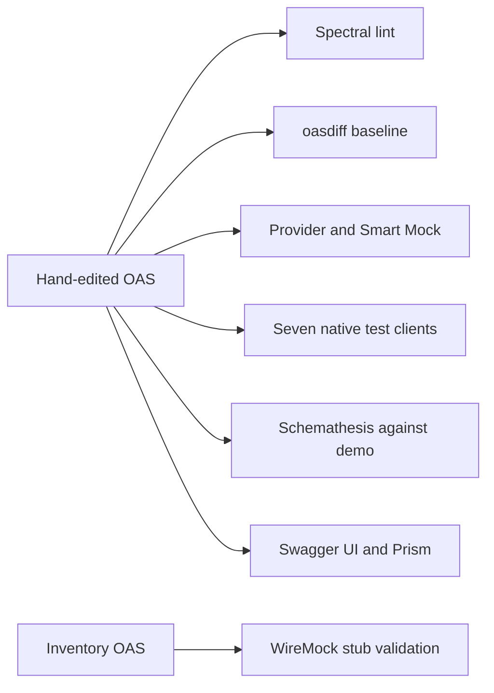

# oas-polycontract roadmap

One hand-edited contract per API boundary. Native tests and contract tools read it; generated views never become another source of truth.

## Guiding rule

One role owns the contract. Clear ownership means less maintenance and more trust. Providers and consumers use the same contract revision. WireMock mappings describe a downstream dependency and are checked against that dependency's contract.

## Status — 16 November 2026

| Area | Implementation | Verification or remaining work |
|---|---|---|
| Runnable demo | Node Product API, inventory dependency, WireMock, Specmatic provider and downstream tests, success and error examples | Expanded pipeline needs a fresh CI run. |
| Governance | Spectral for OAS and AsyncAPI, oasdiff against the root baseline, Schemathesis against the live demo | New gates await CI execution. The root Product Catalog contract has no provider implementation. |
| Language clients | Rust, Go, Python, JavaScript, TypeScript, Java, and C# integration tests read the demo OAS and validate actual responses | Compile and runtime results await CI; local environment has no Docker or the other language toolchains. |
| Consumer mock | JavaScript test exercises Specmatic Smart Mock; mock integration checks inline, VIP external, and dictionary fallback values | New assertions await CI. |
| Protocol coverage | AsyncAPI examples for WebSocket and Kafka, with a separate Spectral ruleset | Contract examples only; no event service or broker is part of the demo. |
| Debug layer | Optional Swagger UI and Prism Compose services use the root contract | Local profile exists; environment-specific host URLs still need deployment configuration. |
| CI and security | Ubuntu contract workflow; CodeQL, Gitleaks, Trivy, Dependency Review, and Dependabot | The prior Specmatic scan lacked its VEX config; the latest scan loads it but still reports the CVE because the VEX statement used its GHSA alias. The latest run also found root-user client images. The VEX ID and seven non-root images are now corrected; rerun the scans. Branch protection is a repository setting. |
| Dependency reproducibility | Direct package versions and container/tool versions are pinned | Most language projects do not yet commit transitive lockfiles. Add native lockfiles after the first green pipeline run, then enforce locked installs. |
| Migration | No legacy Postman or Bruno collection was supplied | Phase 5 is not applicable unless one is provided. |
| Scaffolder | Not implemented | Phase 9 remains open until the end-to-end pipeline is stable. |
| MCP | Design notes only | Optional; keep outside the contract and test source of truth. |

## Contract flow



The repository has two distinct HTTP contracts. `openapi/openapi.yaml` is the root Product Catalog scaffold and its baseline; it has no server. `demo/openapi.yaml` is exercised by the demo app and all seven language clients. `demo/downstream/openapi.yaml` describes the app's WireMock-backed inventory dependency.

## Phases

### Phase 0 — Scaffold

- [x] Repository layout, ownership, contribution guidance, and quick start.

### Phase 1 — Contract source

- [x] Design-first root Product Catalog OAS and pinned baseline.
- [x] Keep the runnable demo's Product API and Inventory API as separate boundaries.
- [ ] If the root contract later becomes code-first, regenerate its candidate spec before compatibility checks.

### Phase 2 — Governance

- [x] Lint root, demo, and downstream OpenAPI contracts with Spectral.
- [x] Lint WebSocket and Kafka AsyncAPI examples with Spectral.
- [x] Compare the root contract with its committed baseline using oasdiff.
- [x] Run Schemathesis against the live demo service.
- [x] Test the demo provider and WireMock dependency with Specmatic, including deterministic 404 and 502 examples.
- [ ] Run the expanded gates in CI and configure branch protection to require them.
- [ ] Keep Specmatic behavioral backward-compatibility checking optional; it overlaps the structural oasdiff gate and is not needed for this single baseline.
- [ ] Add a root provider check only if a root API implementation is created.

### Phase 3 — Language-native clients

- [x] Add runtime OAS response validation and a business assertion in Rust (`reqwest` + `jsonschema`), Go (`net/http` + `kin-openapi`), Python (`pytest` + `openapi-core`), JavaScript (`node:test` + `@oaverify`), TypeScript (Vitest + `@oaverify`), Java (JUnit + REST Assured validator), and C# (xUnit + `NJsonSchema`).
- [x] Read the committed `demo/openapi.yaml` directly; do not maintain duplicate schemas or treat generated types as wire validation.
- [x] Add a JavaScript consumer example against the Smart Mock.
- [x] Document how to port requests and assertions from Postman or Bruno in [`clients/README.md`](clients/README.md).
- [ ] Confirm all seven suites pass in the expanded pipeline.

### Protocol scope

- [x] Document file encodings separately from transports and payload media types. OAS covers HTTP with JSON, XML, text, form, multipart, and binary media types when declared.
- [x] Add AsyncAPI 2.6 examples for WebSocket and Kafka and lint them.
- [ ] Add a runtime and compatibility gate for an event protocol when the project includes an event provider or broker.
- [ ] Add gRPC, GraphQL, or SOAP examples only alongside an implementation to exercise.

### Mock data

- [x] Keep common examples in OAS, deterministic request-specific fixtures in `demo/openapi_examples/`, and domain-shaped fallback values in `demo/openapi_dictionary.yaml`.
- [x] Keep AI-assisted fixture generation offline: review, schema-validate, and commit outputs; CI and mock startup do not call a model.
- [x] Validate external examples and add assertions for inline, external, and dictionary responses.
- [ ] Confirm mock-profile behavior in CI.

### Phase 4 — Debugging layer

- [x] Add optional Swagger UI and Prism profiles sourced from the root OAS.
- [x] Keep them for manual exploration; contract tests remain the CI automation source.
- [ ] Configure real dev, staging, and production base URLs when those environments are available.
- [ ] Generate a Bruno debugging collection only if maintainers request one; no legacy collection exists today.

### Phase 5 — Legacy migration

Not applicable with the supplied project: no legacy collection was provided. If one is added, inventory every request and assertion, migrate shape to OAS, move setup to native fixtures, remove duplicate schema assertions, and port business rules once.

### Phase 6 — Compose and local run

- [x] Parameterize runtime and tool image versions in `.github/versions.env`; pin language dependencies in native manifests.
- [x] Compose the demo, seven language suites, governance checks, fuzzing, and mock assertions.
- [x] Have `run.sh` execute the full applicable suite and always tear down containers on success or failure.
- [x] Keep GitHub Actions on Ubuntu; support Docker Desktop or Colima on macOS for local runs.
- [ ] Confirm the full clean-checkout run in CI.

### Phase 7 — CI and security

- [x] Run `bash ./run.sh` in the Ubuntu contract workflow.
- [x] Keep CodeQL, Gitleaks, Trivy, Dependency Review, and weekly Dependabot checks.
- [x] Cover Rust, Go, Python, JavaScript/TypeScript, Java, C#, and GitHub Actions with CodeQL; use the language-appropriate build mode.
- [x] Apply Specmatic's upstream OpenVEX assessment through the Trivy config for its bundled Guava finding.
- [ ] Confirm the updated Trivy scan accepts the VEX disposition and passes on Specmatic 2.56.3.
- [ ] Review the new workflow results and set required status checks in GitHub repository settings.

### Phase 8 — Docs

- [x] Consolidate the README around the contract flow, runnable example, native suites, protocol scope, mock data, and contribution path.
- [x] Document the example output and migration workflow.
- [x] Keep roadmap status aligned with implementation and verification state.

### Phase 9 — Reusable scaffolder

- [ ] Build the optional `create-polycontract` CLI only after the new pipeline is stable.
- [ ] Support `init` and additive `add` commands, non-interactive flags, safe prompts, and a manifest that prevents overwriting hand-edited files.
- [ ] Generate only selected clients, gates, debug services, and CI configuration from maintained templates.

## Remaining work and acceptance criteria

These are the current gaps, in execution order. “Implemented” means files and wiring exist; it does not imply a successful CI run.

| Priority | Gap | Status | Acceptance signal |
|---|---|---|---|
| P0 | Run the expanded contract and security workflows on this implementation | Implemented; fresh run pending | All applicable contract jobs and image/filesystem scans pass; fixes and results are recorded here. |
| P1 | Make language dependency installs reproducible | Needed | Commit JS/TS package locks, `Cargo.lock`, Go module sums, a hash-locked Python requirements file, and NuGet lock files; lock Maven dependency resolution. Use lock-enforcing installs in the container builds. |
| P1 | Require contract and security checks before merge | Repository configuration needed | GitHub branch protection requires the named checks. This setting is managed outside this repository. |
| P2 | Decide whether the root Product Catalog OAS remains contract-only | Decision needed | If it stays a scaffold, keep provider checks on the demo OAS. If a root provider is added, add provider and client examples against the root contract. |
| Conditional | Exercise event protocols at runtime | Not applicable yet | Add a WebSocket or Kafka provider/broker and contract tests when the project includes one. The current AsyncAPI files are linted examples only. |
| Conditional | Configure deployed debug URLs | Environment details needed | Add the real dev, staging, and production endpoints when those environments exist. |
| Conditional | Migrate legacy requests and assertions | Not applicable yet | Inventory a supplied Postman or Bruno collection, move request shape to OAS, and port genuine business rules to one native suite. |
| Later | Build the optional `create-polycontract` CLI | Deferred until P0 and P1 are complete | `init` and additive `add` generate a selected starter that passes this pipeline without overwriting hand-edited files. |
| Optional | Add MCP support | Design only | Add it only if it wraps checked-in commands without creating another contract or test source of truth. |

## Progress log

| Date | Change | Status |
|---|---|---|
| 16 Nov 2026 | Added seven native HTTP client suites, Smart Mock assertions, WebSocket and Kafka AsyncAPI examples, security workflows, and full Compose wiring. | Implemented; CI verification pending. |
| 16 Nov 2026 | Expanded the README with contract boundaries, pipeline flow, and a repository tree. | Done. |
| 16 Nov 2026 | Added an ordered gap register and acceptance signals for CI verification, dependency locks, branch protection, and conditional phases. | Done; open items remain listed above. |
| 16 Nov 2026 | Expanded CodeQL to all seven client languages and GitHub Actions, with separate build-mode settings. | Implemented; workflow results are pending. |
| 16 Nov 2026 | Reviewed contract run [43884547902](https://github.com/shoman2020/oas-polycontract/actions/runs/43884547902): the app and WireMock image scans passed, while Specmatic's bundled Guava finding failed the scan because the VEX config was not passed. | Added the `trivy-config` input to the contract workflow; the revised scan still needs a run. |
| 16 Nov 2026 | The expanded filesystem scan in security run [43931893077](https://github.com/shoman2020/oas-polycontract/actions/runs/43931893077) flagged all seven client test images for running as root. | Added dedicated non-root users and writable test directories to the seven client images. Rerun the scan to confirm. |
| 16 Nov 2026 | The contract build showed that the .NET runtime patch version is not an SDK image tag; Specmatic's scan loaded VEX but reported the CVE because its name used a GHSA alias. | Updated the SDK pin to 10.0.404 and normalized the VEX vulnerability name to CVE-2026-102554. The next CI run will verify both fixes. |

## Run and expected result

```sh
bash ./run.sh
```

The run lints contracts, checks compatibility, builds the demo and clients, tests WireMock and Specmatic, fuzzes the demo, validates responses in each language, and exercises the Smart Mock data sources. Language-specific output examples are in [`clients/README.md`](clients/README.md). CI output is the verification record; a local run requires Docker and Compose.

## Recommendations

1. Run CI on the complete implementation and fix failures before declaring the client suites stable.
2. Generate and commit native dependency lockfiles, then enforce locked installs so clean builds use the reviewed dependency graph.
3. Require the contract and security checks in GitHub branch protection.
4. Decide whether the root Product Catalog OAS remains contract-only; keep demo provider coverage separate either way.
5. Add event runtime tests and deployed debug URLs only when the services and environments exist.
6. Start Phase 9 after a green, reproducible end-to-end pipeline.
7. Keep MCP optional and outside CI's contract source of truth.
