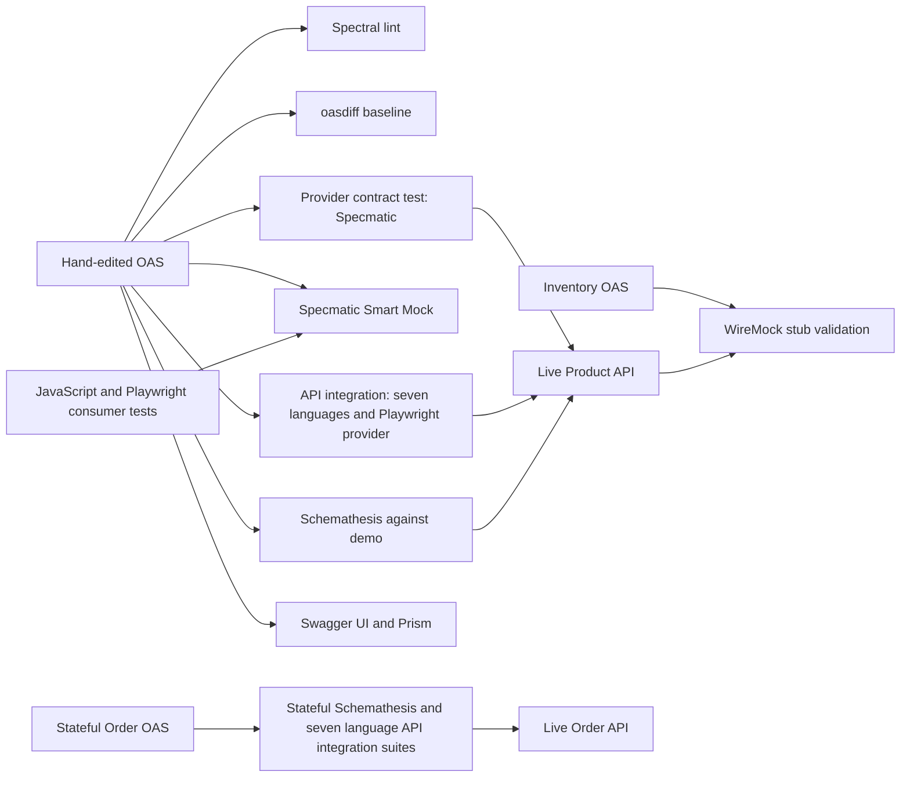

# oas-polycontract roadmap

One hand-edited contract per API boundary. Native tests and contract tools read it; generated views never become another source of truth.

## Guiding rule

One role owns the contract. Clear ownership means less maintenance and more trust. Providers and consumers use the same contract revision. WireMock mappings describe a downstream dependency and are checked against that dependency's contract.

## Status — 17 November 2026

| Area | Implementation | Verification or remaining work |
|---|---|---|
| Runnable demo | Product API, isolated linked Order API, inventory dependency, WireMock, Specmatic provider and downstream tests | Contract run [44046941415](https://github.com/shoman2020/oas-polycontract/actions/runs/44046941415) passed the full contract pipeline, including both Schemathesis phases, provider and consumer examples, all seven native suites, Playwright, and image scans. |
| Governance | Spectral for OAS and AsyncAPI, oasdiff against the root baseline, stateless and stateful Schemathesis | Passed in run 44046941415. Stateful tests exercise linked operations and stateless fuzzing checks independent Product API requests. |
| Language and API test clients | Rust, Go, Python, JavaScript, TypeScript, Java, and C# validate Product API and Order API responses; Playwright covers Product API | All seven native suites and both Playwright targets passed in run 44046941415. |
| Provider and consumer contract roles | Specmatic provider verification targets the running app; JavaScript and Playwright consumer suites target the Specmatic Smart Mock | Provider, deterministic external example, dictionary fallback, and consumer checks passed. Consumers use the shared provider OAS; no separate consumer-owned CDC artifact is published. |
| Protocol coverage | AsyncAPI examples for WebSocket and Kafka, with a separate Spectral ruleset | Contract examples only; no event service or broker is part of the demo. |
| Debug layer | Optional Swagger UI and Prism Compose services use the root contract | Local profile exists; environment-specific host URLs still need deployment configuration. |
| CI and security | Ubuntu contract workflow; CodeQL, Gitleaks, Trivy, Dependency Review, and Dependabot | Contract run 44052746009 passed. Its warnings were reviewed and fixes are in this patch. Trivy scans built runtime images in `contract.yml` and repository dependencies/configuration in `security.yml`; Gitleaks owns secret scanning. Required branch-protection checks still need repository settings. |
| Dependency reproducibility | JavaScript, TypeScript, Playwright, and the dependency-free demo app have npm lockfiles; Node test images use `npm ci`. Python uses a hash-locked requirements file; Java enforces dependency convergence and pins Maven plugins. | Rust `Cargo.lock`, Go `go.sum` read-only mode, and C# NuGet lock restore remain open. A clean full-pipeline check is still required. |
| Showcase publishing | Interactive HTML is checked in and a GitHub Pages workflow builds it as `index.html` | Run [44046941399](https://github.com/shoman2020/oas-polycontract/actions/runs/44046941399) could not configure Pages because Pages is not enabled for the repository. Enable Pages with GitHub Actions in repository settings, then rerun. |
| Repository evaluations | `evals/project-evals.json` checks structure, test roles, workflow visuals, and roadmap; `evals/mock-data-evals.json` defines mock response cases | Local Node run passed 8/8 evaluation groups. Docker is unavailable in this checkout, so Compose parsing and container execution remain for CI verification. |
| Migration | No legacy Postman or Bruno collection was supplied | Phase 5 is not applicable unless one is provided. |
| Repository structure | Active files are grouped by contracts, demo services, clients, gates, docs, and GitHub automation | Removed empty placeholder folders that had no implementation or references. Recreate a directory when its first maintained file is ready. |
| Scaffolder | Not implemented | Phase 13 remains optional; wait for reproducible dependencies, required CI checks, and maintainer requirements first. |
| MCP | Not implemented | Optional; consider only for a concrete workflow and keep it outside the contract and test source of truth. |

## Contract flow



The repository has two distinct HTTP contracts. `openapi/openapi.yaml` is the root Product Catalog scaffold and its baseline, with a local server URL for tooling. `demo/openapi.yaml` is exercised by the demo app, seven language-native suites, and Playwright API tests. `demo/downstream/openapi.yaml` describes the app's WireMock-backed inventory dependency.

Specmatic's provider contract test sends contract-derived requests to the live app. Its consumer examples send client requests to a Smart Mock created from the same OAS. The seven native language suites and Playwright provider suite call the live Product API as API integration tests; the seven native suites also exercise the separate stateful Order API. These test sources and targets are listed in the README test map.

## Phases

### Phase 0 — Scaffold

- [x] Repository layout, ownership, contribution guidance, and quick start.

### Phase 1 — Contract source

- [x] Design-first root Product Catalog OAS and pinned baseline.
- [x] Keep the runnable demo's Product API and Inventory API as separate boundaries.
- [ ] If the root contract later becomes code-first, regenerate its candidate spec before compatibility checks.

### Phase 2 — Governance

- [x] Lint root, demo, and downstream OpenAPI contracts with Spectral.
- [x] Lint WebSocket and Kafka AsyncAPI examples with Spectral.
- [x] Compare the root contract with its committed baseline using oasdiff.
- [x] Run Schemathesis against the live demo service.
- [x] Add a separate stateful Order API with linked OAS operations and run Schemathesis' stateful phase against it.
- [x] Test the demo provider and WireMock dependency with Specmatic, including deterministic 404 and 502 examples.
- [x] Return a declared `405 Method Not Allowed` with `Allow: GET` for unsupported methods on known routes; add the response to the demo OAS.
- [x] Run the expanded gates in CI; the latest full contract run passed in run 44052746009. Its logs were reviewed for lint, build, and analyzer warnings; fixes are included in this patch and will be confirmed by the next run.
- [ ] Configure branch protection to require contract and security status checks.
- [x] Keep Specmatic behavioral backward-compatibility checking out of the current gates; it overlaps oasdiff for the single root baseline.

Conditional: add a root provider check if a service is implemented for the root Product Catalog contract.

### Phase 3 — Language-native clients

- [x] Add runtime OAS response validation and a business assertion in Rust (`reqwest` + `jsonschema`), Go (`net/http` + `kin-openapi`), Python (`pytest` + `openapi-core`), JavaScript (`node:test` + `@oaverify`), TypeScript (Vitest + `@oaverify`), Java (JUnit + REST Assured validator), and C# (xUnit + `NJsonSchema`).
- [x] Read the committed `demo/openapi.yaml` directly; do not maintain duplicate schemas or treat generated types as wire validation.
- [x] Encapsulate HTTP setup in idiomatic API client objects for all seven languages; keep OAS validation and business assertions distinct where the native framework supports it.
- [x] Add a JavaScript consumer example against the Smart Mock.
- [x] Add Playwright APIRequestContext provider integration and Smart Mock consumer examples; no browser binary is needed for API-only tests.
- [x] Add create/read/confirm/delete/post-delete-404 integration flows with OAS response validation in all seven native languages.
- [x] Wire the separate stateful contract and provider into the seven language test containers.
- [x] Keep provider verification, consumer-side mock tests, and live-server API integration suites distinct in the README and runnable examples.
- [x] Document how to port requests and assertions from Postman or Bruno in [`clients/README.md`](clients/README.md).
- [x] Confirm the stateful and Product API scenarios pass in all seven language suites and both Playwright targets in run 44046941415.

### Protocol scope

- [x] Document file encodings separately from transports and payload media types. OAS covers HTTP with JSON, XML, text, form, multipart, and binary media types when declared.
- [x] Add AsyncAPI 2.6 examples for WebSocket and Kafka and lint them.
- [ ] Add a runtime and compatibility gate for an event protocol when the project includes an event provider or broker.
- [ ] Add gRPC, GraphQL, or SOAP examples only alongside an implementation to exercise.

### Mock data

- [x] Keep common examples in OAS, deterministic request-specific fixtures in `demo/openapi_examples/`, and domain-shaped fallback values in `demo/openapi_dictionary.yaml`.
- [x] Keep AI-assisted fixture generation offline: review, schema-validate, and commit outputs; CI and mock startup do not call a model.
- [x] Validate external examples and assert deterministic request-matched and dictionary-backed mock responses.
- [x] Confirm deterministic fixtures, dictionary fallback, and mock-profile consumer behavior in run 44046941415.

### Phase 4 — Debugging layer

- [x] Add optional Swagger UI and Prism profiles sourced from the root OAS.
- [x] Keep them for manual exploration; contract tests remain the CI automation source.

Conditional: configure environment URLs when deployments exist. Keep a Bruno collection out of scope unless maintainers request one; no legacy collection is present.

### Phase 5 — Legacy migration

Not applicable with the supplied project: no legacy collection was provided. If one is added, inventory every request and assertion, migrate shape to OAS, move setup to native fixtures, remove duplicate schema assertions, and port business rules once.

### Phase 6 — Compose and local run

- [x] Parameterize runtime and tool image versions in `.github/versions.env`; pin language dependencies in native manifests.
- [x] Compose the demo, seven language suites, Playwright provider and consumer tests, governance checks, fuzzing, and mock assertions.
- [x] Have `run.sh` execute the full applicable suite and always tear down containers on success or failure.
- [x] Keep GitHub Actions on Ubuntu; support Docker Desktop or Colima on macOS for local runs.
- [x] Confirm the full clean-checkout run in CI, including the stateful provider, Schemathesis phase, and all seven native lifecycle suites (run 44052746009).

### Phase 7 — CI and security

- [x] Run `bash ./run.sh` in the Ubuntu contract workflow.
- [x] Keep CodeQL, Gitleaks, Trivy, Dependency Review, and weekly Dependabot checks.
- [x] Cover Rust, Go, Python, JavaScript/TypeScript, Java, C#, and GitHub Actions with CodeQL; use the language-appropriate build mode.
- [x] Apply Specmatic's upstream OpenVEX assessment through the Trivy config for its bundled Guava finding.
- [x] Confirm the updated Trivy scan accepts the VEX disposition and passes on Specmatic 2.56.3 (contract run 43933329023).
- [x] Review contract workflow results; full contract job passed in run 44052746009. Record the warning fixes in this patch and recheck on the next run.
- [ ] Set required status checks in GitHub repository settings.

### Phase 8 — Docs

- [x] Consolidate the README around the contract flow, runnable example, native suites, protocol scope, mock data, and contribution path.
- [x] Document the example output and migration workflow.
- [x] Distinguish provider and consumer contract tests from native API integration tests by their sources and targets.
- [x] Keep roadmap status aligned with implementation and verification state.
- [x] Replace the autoplay GIF with a manually controlled project showcase and a GitHub Pages deployment workflow.
- [x] Map contract, security, and Pages workflow triggers and responsibilities in the README and interactive showcase.
- [ ] Enable GitHub Pages with the Actions source so the showcase workflow can publish.
- [x] Add executable repository evaluations for documentation, test entry points, pipeline wiring, and roadmap phases.
- [x] Run the evaluation suite in the current checkout; 8/8 groups passed under the local Node.js runtime.
- [ ] Confirm the new Compose evaluator service in a Docker-enabled run.

### Phase 9 — Reproducible dependencies

- [x] Commit package lockfiles for JavaScript, TypeScript, Playwright, and the dependency-free demo app; use `npm ci` in the JavaScript, TypeScript, and Playwright images.
- [ ] Commit `Cargo.lock` and use `cargo test --locked` in the Rust image.
- [ ] Commit `go.sum` and verify clean builds use `-mod=readonly`.
- [x] Generate a hash-locked Python dependency file from the pinned `requirements.txt` and install with `--require-hashes` in a virtual environment.
- [ ] Enable NuGet lock-file generation and locked restore for C#.
- [x] Add Maven dependency-convergence and plugin-version checks; pin the Enforcer, Compiler, and Surefire plugins in the POM.
- [ ] Run the full contract pipeline from a clean checkout and record the resolved dependency graph and result.

### Phase 10 — Repository merge policy

- [ ] Configure GitHub branch protection to require the contract and security workflows on pull requests.
- [ ] Confirm the selected check names remain stable and cannot be bypassed by path filters.

### Phase 11 — Showcase publishing

- [ ] Enable Pages with GitHub Actions as its source and verify the showcase deploys from `docs/project-flow.html`.
- [ ] Confirm the showcase URL in the README resolves to the deployed page.

### Phase 12 — Performance baseline

- [ ] Record stage timings for lint, compatibility, provider checks, fuzzing, client suites, and image scans.
- [ ] Capture at least five clean-run and warm-cache samples before defining a baseline.
- [ ] Report median and range with runner and cache conditions; retain raw timings as workflow artifacts.
- [ ] Keep performance reporting informational until enough history exists to set a useful regression threshold.

### Phase 13 — Optional reusable scaffolder

- [ ] Gather maintainer requirements and define supported starter combinations before implementation.
- [ ] Build the optional `create-polycontract` CLI only after Phases 9 and 10 are complete; use npm only as the distribution channel for this CLI.
- [ ] Support `init` and additive `add` commands, non-interactive flags, safe prompts, and a manifest that prevents overwriting hand-edited files.
- [ ] Generate only selected clients, gates, debug services, and CI configuration from maintained templates.
- [ ] Verify generated starters with the same contract pipeline and test that updates preserve hand-edited files.
- [ ] If npm distribution is selected, test the packed CLI in a clean directory before publishing and document supported Node versions and upgrade behavior.

## Remaining work and acceptance criteria

These are the remaining gaps, in execution order. Repository configuration items require GitHub settings access; conditional items need an implementation or environment before work begins.

| Priority | Gap | Status | Acceptance signal |
|---|---|---|---|
| P1 | Make language dependency installs reproducible | In progress; Phase 9 | npm and Python installs now use committed locks; Maven checks convergence. Add Rust and Go lockfiles, C# NuGet lock mode, then prove a clean checkout passes the full pipeline. |
| P1 | Require contract and security checks before merge | GitHub settings needed; Phase 10 | Enable the stable contract and security checks as required pull request status checks and verify a pull request is blocked on failure. |
| P2 | Publish the interactive showcase | GitHub Pages settings needed; Phase 11 | Enable Pages with GitHub Actions as the source, rerun the workflow, and confirm the README link resolves to the deployed showcase. |
| P2 | Establish a representative performance baseline | No repeated samples yet; Phase 12 | Publish median and range from at least five clean and warm-cache runs with runner/cache conditions and stage timings. |
| Conditional | Exercise event protocols at runtime | No event provider or broker is included | When one is added, choose its AsyncAPI binding, run the service/broker, validate provider behavior and compatibility, and include a runnable example in CI. |
| Conditional | Configure deployed debug URLs | No deployment environments are included | When dev, staging, or production endpoints exist, define environment-specific server URLs and verify debug views target the selected environment. |
| Conditional | Migrate legacy requests and assertions | No legacy Postman or Bruno collection was supplied | When a collection is provided, inventory requests, migrate interface shape to OAS, move setup to fixtures, and port business assertions to one native suite. |
| Later | Build the optional `create-polycontract` CLI | Deferred to Phase 13 | After Phases 9 and 10, define starter combinations; implement `init` and additive `add`, protect hand-edited files, and verify generated starters with CI. |
| Optional | Add MCP support | No concrete project integration identified | Define a user workflow first; expose checked-in commands without introducing another contract or test source of truth. |

## Package suitability

The repository is a multi-language reference implementation, not an importable library. Publishing the full repo as an npm package would mix demos, client suites, contracts, and CI files without giving consumers a stable runtime API.

The useful package candidate is `create-polycontract`: a CLI that generates a selected starter from maintained templates. Keep the repository itself as the documentation and integration test source. A GitHub template repository is the lower-effort first distribution option; a CLI is justified if users need selective language, gate, or protocol choices. Add demand and supported-output requirements before Phase 13. GitHub template repositories copy a repository's default-branch files into a new project; npm distribution would add package versioning and release maintenance ([GitHub template repositories](https://docs.github.com/en/repositories/creating-and-managing-repositories/creating-a-template-repository), [npm publishing](https://docs.npmjs.com/creating-and-publishing-scoped-public-packages/)).

## Progress log

| Date | Change | Status |
|---|---|---|
| 16 Nov 2026 | Added seven native HTTP client suites, Smart Mock assertions, WebSocket and Kafka AsyncAPI examples, security workflows, and full Compose wiring. | Implemented; CI verification pending. |
| 16 Nov 2026 | Expanded the README with contract boundaries, pipeline flow, and a repository tree. | Done. |
| 16 Nov 2026 | Added an ordered gap register and acceptance signals for CI verification, dependency locks, branch protection, and conditional phases. | Done; open items remain listed above. |
| 16 Nov 2026 | Expanded CodeQL to all seven client languages and GitHub Actions, with separate build-mode settings. | Implemented; workflow results are pending. |
| 16 Nov 2026 | Reviewed contract run [43884547902](https://github.com/shoman2020/oas-polycontract/actions/runs/43884547902): the app and WireMock image scans passed, while Specmatic's bundled Guava finding failed the scan because the VEX config was not passed. | Added the `trivy-config` input to the contract workflow; the revised scan still needs a run. |
| 16 Nov 2026 | The expanded filesystem scan in security run [43931893077](https://github.com/shoman2020/oas-polycontract/actions/runs/43931893077) flagged all seven client test images for running as root. | Added dedicated non-root users and writable test directories to the seven client images. Rerun the scan to confirm. |
| 16 Nov 2026 | The contract build showed that the .NET runtime patch version is not an SDK image tag; Specmatic's scan loaded VEX but reported the CVE because its name used a GHSA alias. | Updated the SDK pin to 10.0.404 and normalized the VEX vulnerability name to CVE-2026-102554. The next CI run will verify both fixes. |
| 16 Nov 2026 | Security run [43933329040](https://github.com/shoman2020/oas-polycontract/actions/runs/43933329040) passed. Contract run [43933329023](https://github.com/shoman2020/oas-polycontract/actions/runs/43933329023) passed all three image scans, including the Specmatic VEX disposition, but could not find `maven:3.10.1-eclipse-temurin-25`. | Set `MAVEN_VERSION=3.10.0`, the current published Maven image tag compatible with Java 25. Re-run the contract workflow to exercise builds and contract checks. |
| 16 Nov 2026 | Contract run [43934287219](https://github.com/shoman2020/oas-polycontract/actions/runs/43934287219) used the corrected Maven image and reached the C# image build, where `useradd` conflicted with the .NET SDK image's built-in `app` account. | Removed duplicate account creation; the C# test image now uses Microsoft's built-in non-root account. Re-run the contract workflow. |
| 16 Nov 2026 | Contract run [43935112208](https://github.com/shoman2020/oas-polycontract/actions/runs/43935112208) passed Maven and C# image builds, then failed Rust dependency resolution because `reqwest` 0.13.4 removed the `rustls-tls` feature. | Pinned the current `reqwest` 0.13.5 and switched to its `rustls` feature. Re-run the contract workflow. |
| 16 Nov 2026 | Contract run [43935878603](https://github.com/shoman2020/oas-polycontract/actions/runs/43935878603) passed image builds, WireMock integration, Specmatic provider/downstream checks, and example validation. Schemathesis generated 115 cases in 2.07s and found that `TRACE /healthz` returned 404 instead of 405. Security run [43935878355](https://github.com/shoman2020/oas-polycontract/actions/runs/43935878355) passed. | Added method-aware routing, declared `405` responses and `Allow: GET`, and an integration assertion. Refactored all seven client suites around their language's API client object and documented the live-app versus Smart Mock topology. Rerun the pipeline; client suites were not reached in that run. |
| 16 Nov 2026 | Added Playwright APIRequestContext examples for live-provider integration and Specmatic Smart Mock consumer testing; wired both targets into Compose and `run.sh`. Clarified Specmatic provider versus consumer-side roles and added the eighth test image to the architecture docs. | Implemented; compile and runtime results await CI. |
| 16 Nov 2026 | Contract run [43943340330](https://github.com/shoman2020/oas-polycontract/actions/runs/43943340330) stopped at the version-loading step because Windows CRLF endings in `.github/versions.env` were parsed as a Bash command. | Normalized `.github/versions.env` and `run.sh` to LF; rerun the workflow to verify the pipeline and Playwright suites. |
| 16 Nov 2026 | Contract run [43943834022](https://github.com/shoman2020/oas-polycontract/actions/runs/43943834022) passed version loading and built the app, then Compose reported `no such service: specmatic-mock` while building the Playwright consumer test. | Enabled the `test` and `mock` profiles during the relevant build and consumer run; rerun CI. |
| 16 Nov 2026 | Contract run [43944423021](https://github.com/shoman2020/oas-polycontract/actions/runs/43944423021) passed the mock profile build, provider checks, fuzzing, and image scans, then Rust failed to compile because schema errors borrowed the response body. | Collect schema validation errors into owned strings, then rerun CI and continue through the remaining language clients. |
| 16 Nov 2026 | The pre-fix Rust test blob had mixed endings (1 CRLF and 41 LF), triggering GitHub's editor warning. | The Rust fix normalizes the file; .gitattributes now pins Rust and Markdown files to LF. |
| 16 Nov 2026 | Contract run [43958109468](https://github.com/shoman2020/oas-polycontract/actions/runs/43958109468) passed through Rust, then Go failed because `go mod download` without module arguments did not add archive checksums to `go.sum`. | Changed the Go image to `go mod download all`, which populates those checksums before `go test`. Re-run CI to verify the Go fix and remaining clients. |
| 16 Nov 2026 | The README project overview used abrupt image changes between its architecture, pipeline, fuzzing, and performance views. | A generated slide image was used briefly, then superseded on 17 Nov by the manually navigated HTML showcase. No image generator is part of the current project. |
| 16 Nov 2026 | Contract run [43960107981](https://github.com/shoman2020/oas-polycontract/actions/runs/43960107981) passed Rust and stopped at Go because module metadata needed tidying. | The Go image now runs `go mod tidy`; stateful Order API integration tests are implemented and wired into all seven native language services. Push and verify the complete pipeline. |
| 17 Nov 2026 | Contract run [44037412840](https://github.com/shoman2020/oas-polycontract/actions/runs/44037412840) passed lint, compatibility, WireMock, Specmatic, stateless fuzzing, and all image scans. | The stateful command activated the `test` profile without the `mock` profile required to resolve another test service's dependency. Updated both stateful commands and README instructions to enable both profiles. |
| 17 Nov 2026 | Contract run [44038380564](https://github.com/shoman2020/oas-polycontract/actions/runs/44038380564) ran linked stateful tests and passed 122 of 123 scenarios. | Schemathesis found that the in-memory Order API did not enforce the OAS `sku.maxLength: 64`. Added Unicode code-point length validation and made shutdown include both Compose profiles; rerun CI. |
| 17 Nov 2026 | Contract run [44039147257](https://github.com/shoman2020/oas-polycontract/actions/runs/44039147257) passed 123 stateful scenarios, Rust, Go, Python, JavaScript, TypeScript, Playwright provider, and Java. | C# restore succeeded, but the .NET 10 SDK rejected VSTest execution for the xUnit v3 MTP runner. Switched C# to the documented MTP runner, added `global.json`, and removed VSTest-only output options. |
| 17 Nov 2026 | Contract run [44040312029](https://github.com/shoman2020/oas-polycontract/actions/runs/44040312029) passed stateless checks and 231 of 232 stateful scenarios. | The remaining request had a one-character vertical-tab SKU that satisfied the OAS `minLength: 1`; the server rejected it by trimming whitespace. Validation now uses Unicode code-point length and follows the declared schema. |
| 17 Nov 2026 | Contract run [44040993712](https://github.com/shoman2020/oas-polycontract/actions/runs/44040993712) passed stateful and stateless Schemathesis, all provider checks, and every client suite through Java. | C# compiled far enough to reveal that `NodeAt` returned a `YamlNode` before accessing `Children`. Added an explicit `YamlMappingNode` check and forwarded xUnit cancellation tokens to HTTP requests. |
| 17 Nov 2026 | Contract run [44042036533](https://github.com/shoman2020/oas-polycontract/actions/runs/44042036533) passed stateless checks and found an undeclared PATCH body property accepted by the stateful Order API. | Added request object allowlists to match `additionalProperties: false` for both create and update operations; rerun the stateful phase. |
| 17 Nov 2026 | Contract run [44042797970](https://github.com/shoman2020/oas-polycontract/actions/runs/44042797970) passed all 125 stateful scenarios, Rust, Go, Python, JavaScript, TypeScript, Java, C#, and Playwright provider tests. | It failed only when Compose ran `specmatic-mock-integration-test` without activating the service's `test` and `mock` profiles. Updated that command to enable both; consumer checks remain to verify. |
| 17 Nov 2026 | Contract run [44043831606](https://github.com/shoman2020/oas-polycontract/actions/runs/44043831606) passed stateless and stateful Schemathesis, all seven language suites, Playwright provider checks, and all image scans. | The mock matched no request-response fixture for `/products/demo-sku`, so Specmatic correctly used the dictionary. Added a deterministic external example for that request and corrected the integration test description. |
| 17 Nov 2026 | Replaced the automatic README project-flow GIF with a six-scene interactive showcase. | Added manual navigation, slide markers, keyboard controls, accessible status, reduced-motion handling, and a Pages deployment workflow; no slide timer is used. |
| 17 Nov 2026 | Contract run [44046941415](https://github.com/shoman2020/oas-polycontract/actions/runs/44046941415) passed on the showcase commit. | Showcase run [44046941399](https://github.com/shoman2020/oas-polycontract/actions/runs/44046941399) failed at Configure Pages because GitHub Pages is not enabled for the repository. Updated the pinned configure-pages action to v6.0.0 (Node 24). Enable Pages with the GitHub Actions source in repository Settings > Pages, then rerun the showcase workflow. |
| 17 Nov 2026 | Updated the implementation map and performance snapshot with the implemented language names, Docker Compose, and the passing contract job duration. | Removed overlapping Trivy filesystem secret scanning. Gitleaks handles repository secrets; `security.yml` keeps dependency and configuration checks, while `contract.yml` scans the built runtime images. |
| 17 Nov 2026 | Audited tracked directories against actual files and Compose/workflow references. | Removed empty placeholders for unused `bin`, `legacy`, `debug`, contract-gate, and template paths. Updated the README tree to match maintained files and Compose-owned debug services. |
| 17 Nov 2026 | Reconciled implementation status with passing contract run 44046941415. | Marked the full suite, both Schemathesis modes, native clients, Playwright targets, and Smart Mock examples verified; retained Pages publishing and required branch checks as repository-setting gaps. |
| 17 Nov 2026 | Added explicit next-phase steps and acceptance criteria. | Phase 9 covers native dependency locks; Phase 10 covers required checks; Phase 11 covers Pages; Phase 12 establishes performance sampling; Phase 13 defers the optional scaffolder until its prerequisites and requirements are clear. |
| 17 Nov 2026 | Added repository evaluations and placed them before contract gates in `run.sh`. | The evaluator checks README link and tree integrity, language test entry points, Compose/run wiring, and sequential roadmap phase tracking; verify against this checkout. |
| 17 Nov 2026 | Ran `node evals/run.mjs` in the current checkout. | All 8 evaluation groups passed, including test-target, mock fixture, and workflow visual alignment. Docker CLI is not installed here, so Compose parsing and container execution still need CI verification. |
| 17 Nov 2026 | Added a visual of workflow triggers, responsibilities, and scan ownership to the README and interactive showcase. | Added an evaluation check that keeps both visuals aligned with `contract.yml`, `security.yml`, `showcase.yml`, Dependency Review, Dependabot, and image scans. |
| 17 Nov 2026 | Clarified test type ownership and targets in the README, client guide, and interactive overview. | Provider contract tests target the live Product API; consumer contract examples target the Specmatic Smart Mock; native language suites are API integration tests against the live Product and Order APIs. Added an evaluation that checks this map against Compose configuration. |
| 17 Nov 2026 | Reviewed warnings from the latest green contract run [44052746009](https://github.com/shoman2020/oas-polycontract/actions/runs/44052746009). | Added OAS and AsyncAPI lint metadata, aligned Specmatic examples to their external request examples, passed cancellation tokens to C# reads, moved Rust test-only dependencies, used regular non-root UIDs, added locked Python installs, disabled only Spectral's upstream `DEP0040` warning, and addressed the Docker and Maven build notices. The next pipeline run must confirm the cleanup. |
| 17 Nov 2026 | Implemented the first reproducible-install steps in Phase 9 and added `shift-left.nl` as the maintainer link in the interactive showcase. | Committed npm locks and `npm ci` builds; added Python hash-lock installation and Maven convergence enforcement. Cargo, Go, NuGet locks and clean-pipeline verification remain. |

## Run and expected result

```sh
bash ./run.sh
```

The run lints contracts, checks compatibility, builds the demo and client test images, tests WireMock and Specmatic, fuzzes the demo, validates live responses in seven languages and Playwright, then runs JavaScript and Playwright consumer tests against the Smart Mock. Language-specific output examples are in [`clients/README.md`](clients/README.md). CI output is the verification record; a local run requires Docker and Compose.

## Recommendations

1. Add and enforce native dependency locks before expanding the supported starter matrix.
2. Require the contract and security status checks and enable Pages in repository settings.
3. Record repeated clean and warm-cache timings before describing pipeline performance as a baseline.
4. Keep the root Product Catalog OAS as a design scaffold until a provider implementation is added.
5. Add event runtime tests and deployed debug URLs only when the services and environments exist.
6. Build the optional scaffolder only after the lockfiles and repository gates are stable and its supported outputs are agreed.
7. Keep MCP optional and outside CI's contract source of truth.
